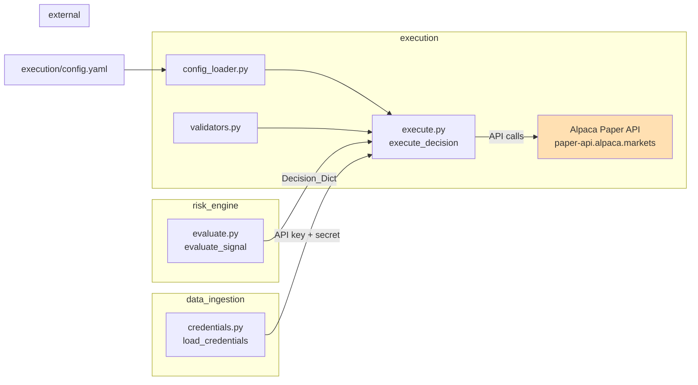

# Design Document: Execution Module

## Overview

The Execution Module is the fourth and final active stage in the Minions paper-trading pipeline. It receives a `Decision_Dict` from the `risk_engine` module, validates it, and — only for APPROVED decisions — places the corresponding order via the Alpaca paper-trading API. BUY signals submit a bracket order (market entry + linked stop-loss); SELL signals submit a plain market sell order (no stop-loss, since SELL closes an existing position). The module polls for fill confirmation and returns a structured `Order_Result` dictionary describing the outcome.

This is the ONLY module in the pipeline permitted to place, modify, or cancel orders.

### Design Goals

- **Safety**: Hard-coded paper-trading enforcement — no configuration, variable, or code path can route to a live account.
- **Explicitness**: Well-commented, readable code appropriate for a developer experienced in C++ but new to Python.
- **Resilience**: All API errors are caught and returned as structured results — the module never crashes the pipeline.
- **Traceability**: Every order submission, fill, rejection, and error is logged as a structured event with the Alpaca order ID.
- **Consistency**: Same file structure pattern as `risk_engine/` and `strategy/` (`config_loader.py`, `validators.py`, main logic, `__init__.py`, `config.yaml`).

### Key Design Decisions

1. **Imperative shell with structured error handling**: Unlike `risk_engine/evaluate.py` (which is a pure function), `execute_decision()` performs real I/O (API calls). Errors are caught and returned as `Order_Result` dicts — never propagated as crashes.
2. **Bracket orders for BUY only**: BUY signals open new positions and need protective stop-losses. SELL signals close existing positions — attaching a stop-loss buy would re-enter the position.
3. **Fallback path for bracket rejection**: If Alpaca rejects the bracket order class, the module falls back to placing a plain market buy first, waiting for fill, then submitting the stop-loss as a separate order.
4. **No automatic retries**: The module attempts each API call once. Retry logic is the pipeline orchestrator's responsibility.
5. **Credential reuse**: Credentials are loaded via `data_ingestion.credentials.load_credentials()` — no separate credential management.
6. **Hypothesis for property-based testing**: Consistent with existing test infrastructure in `tests/test_properties.py` and `tests/test_risk_engine_properties.py`.

---

## Architecture



### Module Boundary

| Boundary | Direction | Data Shape |
|----------|-----------|-----------|
| `risk_engine` → `execution` | Input | `Decision_Dict` with keys: `decision`, `signal`, `position_size`, `stop_loss`, `reason`, `timestamp`, optional `symbol` |
| `data_ingestion.credentials` → `execution` | Input (init only) | `tuple[str, str]` (api_key, secret_key) |
| `execution/config.yaml` → `execution` | Config (init only) | YAML with `fill_timeout_seconds`, `poll_interval_seconds` |
| `execution` → caller | Output | `Order_Result` dict with `status`, `decision`, `signal`, `symbol`, `position_size`, `reason`, `timestamp`, and conditionally `entry_order_id`, `stop_loss_order_id`, `fill_price`, `filled_quantity`, `filled_at`, `error_type`, `cancelled_quantity`, `bracket_fallback` |
| `execution` → Alpaca | I/O | HTTP requests to `paper-api.alpaca.markets` (order submission, status polling, cancellation) |

### Separation of Concerns

- **`config_loader.py`** — Reads and validates `execution/config.yaml`. Only YAML I/O in the module.
- **`validators.py`** — Input validation for `Decision_Dict`. Pure logic, no I/O. Follows the same fail-fast pattern as `risk_engine/validators.py`.
- **`execute.py`** — Contains `execute_decision()` and private helpers for order submission, fill polling, and fallback logic. All Alpaca API interactions happen here.
- **`__init__.py`** — Public API surface. Re-exports `ExecutionConfig`, `load_config`, and `execute_decision`.
- **`config.yaml`** — Default configuration values with explanatory comments.

---

## Components and Interfaces

### 1. `execution/config_loader.py`

```python
from dataclasses import dataclass

@dataclass
class ExecutionConfig:
    """Validated configuration for the execution module."""
    fill_timeout_seconds: float   # [5, 300] — max seconds to wait for fill
    poll_interval_seconds: float  # [0.5, 30] — seconds between status polls

def load_config(config_path: str) -> ExecutionConfig:
    """
    Read execution/config.yaml and return a validated ExecutionConfig.

    Algorithm (mirrors risk_engine/config_loader.py pattern):
      Step 1 — file existence check       → FileNotFoundError
      Step 2 — YAML parsing               → ValueError on syntax error
      Step 3 — non-dict YAML check        → ValueError if parsed to non-dict
      Step 4 — required key presence check → ValueError listing missing keys
      Step 5 — value type and range check  → ValueError identifying invalid key
      Step 6 — warn on unknown keys        → WARNING log, no error
      Step 7 — return ExecutionConfig(...)

    Raises:
        FileNotFoundError: config file absent
        ValueError: invalid YAML, non-dict, missing keys, or constraint violations
    """
```

**Validation Rules** (Step 5):

| Key | Type | Constraint |
|-----|------|-----------|
| `fill_timeout_seconds` | int or float (not bool) | 5 ≤ value ≤ 300 |
| `poll_interval_seconds` | int or float (not bool) | 0.5 ≤ value ≤ 30 |

Booleans are explicitly rejected for all numeric fields (Python quirk: `bool` is a subclass of `int`).

### 2. `execution/validators.py`

```python
import pandas as pd

def validate_decision_dict(decision_dict) -> None:
    """
    Validate the Decision_Dict from the risk engine module.

    Checks are performed in strict sequential order (fail-fast):
      Step 1 — decision_dict is a dict (not None or other type)    → TypeError
      Step 2 — 'decision' key: value in {"APPROVED","VETOED","NO_ACTION"} → ValueError
      Step 3 — 'signal' key: value in {"BUY","SELL","HOLD"}        → ValueError
      Step 4 — 'timestamp' key: UTC-aware pandas Timestamp         → ValueError
      Step 5 — 'reason' key: non-empty string 1–500 chars          → ValueError
      Step 6 — (APPROVED only) 'position_size': positive int ≥ 1   → ValueError
      Step 7 — (APPROVED only) 'stop_loss': positive float > 0.0   → ValueError
      Step 8 — (APPROVED only) 'symbol': non-empty string 1–10 chars → ValueError

    Steps 6–8 are ONLY checked when decision == "APPROVED".
    Each step only executes if all preceding steps have passed.

    Args:
        decision_dict: The Decision_Dict to validate.

    Raises:
        TypeError:  If decision_dict is not a Python dict.
        ValueError: If required keys are missing or values are invalid.
    """
```

### 3. `execution/execute.py`

```python
import logging
import sys
import time
from datetime import datetime, timezone

import pandas as pd
from alpaca.trading.client import TradingClient
from alpaca.trading.requests import (
    MarketOrderRequest,
    StopOrderRequest,
)
from alpaca.trading.enums import OrderSide, TimeInForce, OrderClass

from data_ingestion.credentials import load_credentials
from execution.config_loader import ExecutionConfig, load_config
from execution.validators import validate_decision_dict

# Logger named "execution" — consistent with project conventions.
logger = logging.getLogger("execution")


def _create_paper_client() -> TradingClient:
    """
    Instantiate Alpaca TradingClient with hard-coded paper=True.

    This function:
      1. Loads credentials via data_ingestion.credentials.load_credentials()
      2. Creates TradingClient(api_key, secret_key, paper=True)
         ^^^ paper=True is a HARD-CODED LITERAL — NEVER change this ^^^
      3. Verifies the base URL contains "paper" (case-insensitive)
         If not → raises RuntimeError (live trading forbidden)

    Returns:
        A TradingClient instance connected to the paper-trading endpoint.

    Raises:
        EnvironmentError: If credentials are missing (propagated from load_credentials).
        RuntimeError: If the client's base URL does not contain "paper".
    """

def execute_decision(
    decision_dict: dict,
    config: ExecutionConfig,
    client: TradingClient | None = None,
) -> dict:
    """
    Process a Decision_Dict and place the appropriate order(s) via Alpaca.

    This is the module's primary entry point. It accepts a Decision_Dict
    (output of risk_engine.evaluate_signal), validates it, and either:
      - Returns immediately for non-approved decisions (VETOED/NO_ACTION)
      - Submits the appropriate order(s) for APPROVED decisions
      - Polls for fill confirmation
      - Returns a structured Order_Result

    Algorithm:
      Step 1  — Validate decision_dict (TypeError or ValueError)
      Step 2  — Non-approved pass-through: return "skipped" immediately
      Step 3  — HOLD guard: APPROVED+HOLD is malformed, return "skipped"
      Step 4  — Create/reuse Alpaca paper client
      Step 5  — Submit order (bracket for BUY, plain market for SELL)
      Step 6  — Poll for fill confirmation
      Step 7  — Build and return Order_Result

    Args:
        decision_dict: Decision from risk engine (Decision_Dict).
        config:        Validated ExecutionConfig with timeout/poll params.
        client:        Optional pre-created TradingClient (for testing).
                       If None, creates a new paper client internally.

    Returns:
        Order_Result dict with status and details of the execution attempt.
        Never raises after validation passes — all errors are caught and
        returned as Order_Result with status="error".
    """


def _submit_buy_bracket(
    client: TradingClient,
    symbol: str,
    quantity: int,
    stop_loss_price: float,
) -> dict:
    """
    Submit a bracket order: market buy + stop-loss sell.

    Uses order_class="bracket" to atomically link entry and stop-loss.
    Entry order: time_in_force="day" (market hours only).
    Stop-loss leg: time_in_force="gtc" (remains active until triggered or cancelled).

    If the bracket order is rejected by Alpaca (some symbols don't support
    bracket orders), falls back to:
      1. Submit plain market buy (time_in_force="day")
      2. Wait for fill confirmation
      3. Submit separate stop order for the filled quantity

    Args:
        client:          Alpaca TradingClient (paper).
        symbol:          Ticker to buy (e.g., "AAPL").
        quantity:        Number of shares (positive int).
        stop_loss_price: Price for the stop-loss sell trigger.

    Returns:
        dict with keys: entry_order_id, stop_loss_order_id, bracket_fallback,
        or raises an exception if submission fails entirely.
    """


def _submit_sell_market(
    client: TradingClient,
    symbol: str,
    quantity: int,
) -> dict:
    """
    Submit a plain market sell order (no stop-loss, no bracket).

    SELL signals close existing positions — no protective exit needed.
    time_in_force="day".

    Args:
        client:   Alpaca TradingClient (paper).
        symbol:   Ticker to sell (e.g., "AAPL").
        quantity: Number of shares (positive int).

    Returns:
        dict with keys: entry_order_id, stop_loss_order_id (always None).
    """


def _poll_fill(
    client: TradingClient,
    order_id: str,
    config: ExecutionConfig,
) -> dict:
    """
    Poll Alpaca for order status until terminal state or timeout.

    Polls at config.poll_interval_seconds intervals.
    Terminal states: "filled", "partially_filled" (at timeout),
                    "cancelled", "expired", "rejected".

    If a network error occurs during polling, re-queries once by order ID.

    Algorithm (timing detail):
      1. Record start_time = time.monotonic()
      2. Loop:
         a. Query order status by order_id.
         b. If status is a terminal state → return immediately.
         c. Compute elapsed = time.monotonic() - start_time.
         d. If elapsed >= fill_timeout_seconds → break out of loop
            (proceed to final check below).
         e. Compute remaining = fill_timeout_seconds - elapsed.
         f. sleep_duration = min(poll_interval_seconds, remaining).
            ^^^ This ensures the sleep never overshoots the timeout.
            If only 0.3 s remain but poll_interval is 1.0 s, we sleep 0.3 s.
         g. time.sleep(sleep_duration)
         h. Continue loop (next iteration performs the next status query).
      3. Final check (Requirement 5.5): Query the order one last time.
         - If now terminal → return that status.
         - If still non-terminal → cancel the order, return status="timeout".

    This design guarantees:
      - The final status query always happens regardless of timing.
      - The loop never sleeps past the configured timeout — it clamps
        the sleep to the remaining budget before each wait.
      - The timeout is measured from wall-clock elapsed time (monotonic),
        not from counting sleep intervals, so API latency is included
        in the budget.

    Args:
        client:   Alpaca TradingClient (paper).
        order_id: Alpaca order ID string to poll.
        config:   ExecutionConfig with timeout and poll interval.

    Returns:
        dict describing the terminal state (status, fill_price, filled_quantity,
        filled_at, or terminal status info).
    """
```

### 4. `execution/__init__.py`

```python
"""
execution/ — Order Execution Module for the Minions paper-trading pipeline.

LIVE TRADING IS FORBIDDEN. This module is restricted to Alpaca paper trading
only. The TradingClient is instantiated with paper=True as a hard-coded
literal. No configuration parameter, environment variable, or code path may
route orders to a live brokerage account.
"""

from execution.config_loader import ExecutionConfig, load_config
from execution.execute import execute_decision

__all__ = ["ExecutionConfig", "load_config", "execute_decision"]
```

### 5. `execution/config.yaml`

```yaml
# execution/config.yaml
# =====================
# Configuration for the Order Execution module.
#
# These values control order fill confirmation behavior.
# Both parameters are required — remove or invalidate any one and
# the module will refuse to start (raising ValueError).

# fill_timeout_seconds: Maximum number of seconds to wait for an order
# to reach a terminal state (filled, cancelled, expired, rejected)
# before giving up and cancelling the order.
# Type: int or float, range: [5, 300].
fill_timeout_seconds: 30

# poll_interval_seconds: How frequently (in seconds) to poll the Alpaca
# API for the current order status during fill confirmation.
# Type: int or float, range: [0.5, 30].
poll_interval_seconds: 1.0
```

---

## Data Models

### Input: Decision_Dict (from risk engine)

```python
{
    "decision": "APPROVED" | "VETOED" | "NO_ACTION",  # Exactly one
    "signal": "BUY" | "SELL" | "HOLD",                # Original signal
    "position_size": int,                              # ≥ 1 for APPROVED, 0 otherwise
    "stop_loss": float | None,                         # Positive for APPROVED BUY, None for VETOED/NO_ACTION
    "reason": str,                                     # Non-empty, 1–500 chars
    "timestamp": pd.Timestamp,                         # UTC-aware, from original signal
    "symbol": str,                                     # REQUIRED for APPROVED; optional for VETOED/NO_ACTION
}
```

### Output: Order_Result

```python
# Base fields (always present):
{
    "status": str,              # One of: "filled", "partial_fill", "cancelled",
                                #         "expired", "rejected", "timeout",
                                #         "skipped", "error"
    "decision": str,            # Original decision string ("APPROVED", "VETOED", "NO_ACTION")
    "signal": str,              # Original signal string ("BUY", "SELL", "HOLD")
    "symbol": str | None,       # Ticker from Decision_Dict, or None if not present
    "position_size": int,       # Requested quantity (0 for skipped/error, ≥ 1 for APPROVED)
    "reason": str,              # Non-empty explanation of outcome (1–500 chars)
    "timestamp": pd.Timestamp,  # Original Decision_Dict timestamp (UTC-aware)
}

# Additional fields for "filled" or "partial_fill":
{
    "entry_order_id": str,              # Alpaca order ID
    "stop_loss_order_id": str | None,   # Alpaca stop-loss order ID (None for SELL)
    "fill_price": float,                # Positive fill price (> 0.0)
    "filled_quantity": int,             # Actual shares filled (≥ 1)
    "filled_at": pd.Timestamp,          # UTC-aware fill timestamp
}

# Additional field for "partial_fill":
{
    "cancelled_quantity": int,  # Shares cancelled after timeout (≥ 1)
}

# Additional fields for terminal non-filled states ("cancelled", "expired", "rejected", "timeout"):
{
    "entry_order_id": str,     # Alpaca order ID for traceability
}

# Additional fields for "error":
{
    "entry_order_id": str | None,  # Present if error occurred after submission
    "error_type": str,             # Exception class name
}

# Optional field (BUY fallback path only):
{
    "bracket_fallback": bool,  # True if bracket was rejected and fallback was used
}
```

### Configuration: ExecutionConfig

```python
@dataclass
class ExecutionConfig:
    fill_timeout_seconds: float   # [5, 300] — max wait for fill
    poll_interval_seconds: float  # [0.5, 30] — polling frequency
```

---

## Correctness Properties

*A property is a characteristic or behavior that should hold true across all valid executions of a system — essentially, a formal statement about what the system should do. Properties serve as the bridge between human-readable specifications and machine-verifiable correctness guarantees.*

### Property 1: Non-dict input raises TypeError with type name

*For any* value that is not a Python dictionary (including `None`, integers, strings, lists, floats, booleans), calling `execute_decision` with that value as the `decision_dict` argument SHALL raise a `TypeError` whose message contains the name of the actual type received.

**Validates: Requirements 1.1**

### Property 2: Validation order is strictly sequential (fail-fast)

*For any* dictionary that is invalid in multiple ways, calling `execute_decision` SHALL raise an exception corresponding to the first violation in the defined validation order: (1) type check → (2) `decision` key → (3) `signal` key → (4) `timestamp`/`reason` → (5) `position_size`/`stop_loss` → (6) `symbol`. Within each step, the first sub-check that fails is reported. Subsequent steps are never reached.

**Validates: Requirements 1.2, 1.3, 1.4, 1.5, 1.6, 1.7**

### Property 3: Non-approved decisions return skipped with no API interaction

*For any* valid Decision_Dict where `decision` is `"VETOED"` or `"NO_ACTION"` (with any valid signal, symbol, reason, and timestamp values), calling `execute_decision` SHALL return an Order_Result with `status` equal to `"skipped"`, `decision` equal to the original decision string, `signal` equal to the original signal, `position_size` equal to `0`, and `timestamp` equal to the original timestamp — and SHALL NOT invoke any method on the Alpaca TradingClient.

**Validates: Requirements 2.1, 2.2, 2.3**

### Property 4: BUY bracket order construction

*For any* valid APPROVED BUY Decision_Dict (with varying `symbol`, `position_size`, and `stop_loss` values), calling `execute_decision` with a mocked Alpaca client SHALL submit a bracket order where: (a) the entry leg is a market buy for the given symbol and quantity with `time_in_force="day"`, (b) the stop-loss leg is a stop sell at exactly the `decision_dict["stop_loss"]` price with `time_in_force="gtc"`, and (c) the order class is `"bracket"`.

**Validates: Requirements 3.1, 3.3, 3.4, 4.1, 4.2**

### Property 5: SELL plain market order construction

*For any* valid APPROVED SELL Decision_Dict (with varying `symbol`, `position_size`, and `stop_loss` values), calling `execute_decision` with a mocked Alpaca client SHALL submit a plain market sell order for the given symbol and quantity with `time_in_force="day"`, and SHALL NOT submit any stop-loss order or use bracket order class — regardless of the `stop_loss` value present in the Decision_Dict.

**Validates: Requirements 3.2, 3.7, 4.7**

### Property 6: Order_Result structure invariant

*For any* invocation of `execute_decision` that does not raise an exception (i.e., passes input validation), the returned dictionary SHALL always contain exactly the base keys `{status, decision, signal, symbol, position_size, reason, timestamp}`; `status` SHALL be one of the eight defined values (`"filled"`, `"partial_fill"`, `"cancelled"`, `"expired"`, `"rejected"`, `"timeout"`, `"skipped"`, `"error"`); `reason` SHALL be a non-empty string of 1–500 characters; and `timestamp` SHALL be a UTC-aware pandas Timestamp.

**Validates: Requirements 11.1, 11.4**

### Property 7: Config validation rejects invalid values

*For any* configuration value where `fill_timeout_seconds` is not a number in range [5, 300], or `poll_interval_seconds` is not a number in range [0.5, 30], or either value is a boolean, or the YAML is missing required keys, calling `load_config` SHALL raise a `ValueError` whose message identifies the invalid or missing key.

**Validates: Requirements 8.2, 8.6, 8.7**

### Property 8: Unexpected exceptions are caught and returned as error results

*For any* valid APPROVED Decision_Dict where the Alpaca client raises an unexpected exception (any exception type) during order submission or polling, `execute_decision` SHALL NOT propagate the exception to the caller — it SHALL catch it and return an Order_Result with `status` equal to `"error"` and `reason` containing a description of the failure.

**Validates: Requirements 12.4**

### Property 9: entry_order_id reflects submission state

*For any* invocation of `execute_decision` that results in `status` equal to `"error"`: if the error occurred AFTER the Alpaca API returned a successful order submission (order ID was assigned), `entry_order_id` SHALL be present and non-None; if the error occurred BEFORE or DURING submission (no order ID was assigned), `entry_order_id` SHALL be `None`.

**Validates: Requirements 12.7**

---

## Error Handling

### Error Hierarchy

| Error Type | When Raised | Meaning |
|-----------|-------------|---------|
| `FileNotFoundError` | `load_config()` | Config file not found at expected path |
| `TypeError` | `execute_decision()` (via validator) | `decision_dict` is not a dict |
| `ValueError` | `load_config()` or `execute_decision()` (via validator) | Data/config fails validation |
| `RuntimeError` | `_create_paper_client()` | Base URL does not contain "paper" (safety violation) |
| `EnvironmentError` | Propagated from `load_credentials()` | API credentials missing from `.env` |

### Error Propagation Strategy

- **Validation errors propagate**: `TypeError`, `ValueError`, `RuntimeError`, and `EnvironmentError` are raised to the caller. These indicate precondition failures that must be fixed before the module can operate.
- **API errors are caught and returned**: After validation passes, ALL exceptions (HTTP errors, network timeouts, unexpected errors) are caught and returned as `Order_Result` dicts with `status="error"`. The pipeline never crashes from an API failure.
- **Logging failures are swallowed**: If a `logging` call raises, the exception is caught, a fallback message is written to `sys.stderr`, and execution continues. Logging must never block order placement.
- **No retries**: The module reports the failure and returns. The pipeline orchestrator decides whether to retry.

### Validation Order in `validate_decision_dict()`

1. Type check → `TypeError` (decision_dict not a dict)
2. `decision` key → `ValueError` (missing or not in valid set)
3. `signal` key → `ValueError` (missing or not in valid set)
4. `timestamp` key → `ValueError` (missing or not UTC-aware pd.Timestamp)
5. `reason` key → `ValueError` (missing, not string, or length outside 1–500)
6. (APPROVED only) `position_size` → `ValueError` (missing, bool, not int, or < 1)
7. (APPROVED only) `stop_loss` → `ValueError` (missing, bool, not float/int, or ≤ 0)
8. (APPROVED only) `symbol` → `ValueError` (missing, not string, or length outside 1–10)

### Validation Order in `load_config()`

1. File existence → `FileNotFoundError`
2. YAML parsing → `ValueError`
3. Non-dict check → `ValueError`
4. Required keys present → `ValueError`
5. Value type and range → `ValueError`
6. Unknown keys → WARNING log (no error)

---

## Testing Strategy

### Testing Framework

- **pytest** — test runner (already in `requirements.txt`)
- **Hypothesis** — property-based testing library (already in `requirements.txt`, used in existing `tests/test_properties.py` and `tests/test_risk_engine_properties.py`)

### Dual Testing Approach

#### Property-Based Tests (Hypothesis)

Each correctness property maps to one property-based test function, configured with `@settings(max_examples=100)` minimum. Tests are tagged with comments referencing the design property:

```python
# Feature: execution, Property 1: Non-dict input raises TypeError with type name
```

Properties 1–9 from the Correctness Properties section above will each be implemented as a single Hypothesis property test.

**Generator strategies needed:**

```python
def valid_decision_dict(decision_type="APPROVED"|"VETOED"|"NO_ACTION", signal_type="BUY"|"SELL"|"HOLD"):
    """Generate valid Decision_Dict with specified decision and signal type."""

def valid_approved_buy_decision():
    """Generate valid APPROVED BUY Decision_Dict with random symbol, position_size, stop_loss."""

def valid_approved_sell_decision():
    """Generate valid APPROVED SELL Decision_Dict with random symbol, position_size."""

def valid_non_approved_decision():
    """Generate valid VETOED or NO_ACTION Decision_Dict."""

def invalid_decision_dict_non_dict():
    """Generate non-dict values (None, int, str, list, float, bool)."""

def invalid_decision_dict_content(step: int):
    """Generate dicts that are valid up to step N-1 but invalid at step N."""

def valid_execution_config():
    """Generate valid ExecutionConfig with params in valid ranges."""

def invalid_config_values():
    """Generate config dicts with invalid values for each key."""

def mock_alpaca_client(submit_result=..., poll_result=...):
    """Create a mock TradingClient with configurable responses."""
```

#### Unit Tests (Example-Based)

Targeted tests for specific scenarios not well-covered by property tests:

- `test_config_file_not_found` — verifies `FileNotFoundError` with path in message
- `test_config_invalid_yaml_syntax` — verifies `ValueError` on malformed YAML
- `test_config_loads_default_values` — verifies default config.yaml loads correctly
- `test_config_unknown_keys_warning` — verifies unknown keys logged at WARNING, no error
- `test_approved_hold_returns_skipped` — guards against APPROVED+HOLD malformed dict
- `test_bracket_order_rejected_fallback` — verifies fallback to plain market + separate stop
- `test_fallback_stop_loss_submission_fails` — entry placed but stop-loss fails → error
- `test_order_filled_result_structure` — verifies filled Order_Result has all required fields
- `test_partial_fill_at_timeout` — verifies cancellation and partial_fill result
- `test_order_cancelled_before_fill` — verifies terminal state handling
- `test_order_timeout_cancel` — verifies timeout → cancel → result
- `test_network_error_during_polling_requery` — verifies single re-query on polling failure
- `test_http_error_during_submission` — verifies error result with HTTP details
- `test_paper_safety_base_url_check` — verifies RuntimeError if URL lacks "paper"
- `test_credential_error_propagated` — verifies EnvironmentError propagates unchanged
- `test_logging_failure_swallowed` — verifies stderr fallback when logging raises
- `test_log_event_order_submitted` — verifies structured log on submission
- `test_log_event_order_filled` — verifies structured log on fill
- `test_log_event_decision_skipped` — verifies structured log for non-approved

#### Static Analysis / Smoke Tests

- `test_paper_true_ast_scan` — AST scan of all `.py` files in `execution/` verifying:
  - `paper=True` appears in every `TradingClient` instantiation
  - No `paper=False` or omitted `paper` parameter exists
  - No variable assignment is used for the `paper` parameter value
- `test_no_direct_env_reading` — AST scan verifying `execution/` does not import `dotenv` or read `.env` directly
- `test_no_retry_on_submission_failure` — Behavioral test: mock the Alpaca client to raise an exception on the first `submit_order` call, assert `execute_decision` returns `status="error"`, and assert the mock was called exactly once (proving the module does not retry failed submissions). This tests the "no retry" property directly rather than inferring it from source code shape, which cannot reliably distinguish the legitimate polling loop (Requirement 5.1) from a forbidden retry loop.
- `test_init_docstring_forbids_live` — verifies `__init__.py` module docstring mentions live trading is forbidden

### Test File Organization

```
tests/
├── test_execution_properties.py    # Property-based tests (Properties 1–9)
├── test_execution_unit.py          # Example-based unit tests
└── test_execution_safety.py        # AST-scan smoke tests for paper trading safety
```

### Property Test Configuration

- Minimum 100 iterations per property test (`@settings(max_examples=100)`)
- Each test tagged: `Feature: execution, Property {N}: {title}`
- Symbol generators use 1–5 uppercase letters for realistic tickers
- Position size generators use range [1, 10000]
- Stop-loss generators use realistic prices [0.01, 100000.0]
- Mock Alpaca client used for all property tests involving API calls (no real network I/O)
- Config generators use sub-ranges within valid bounds for test efficiency