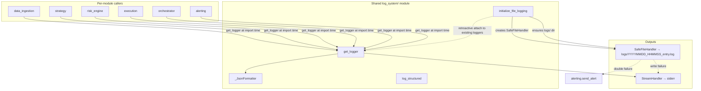
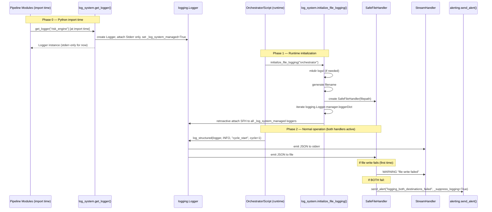

# Design Document

## Overview

This design describes a centralized file-based logging system for the Minions paper-trading bot. The system relocates the existing `_JsonFormatter` and `get_logger()` infrastructure from `data_ingestion/logger.py` into a new shared `log_system/` module at the project root. All six modules (Data Ingestion, Strategy, Risk Engine, Execution, Orchestrator, Alerting) will obtain their loggers from this shared module and emit structured JSON log records to both stderr (preserving current behavior) and a per-run log file under `logs/`.

Key design goals:
- **No new JSON formatter**: Reuse the existing `_JsonFormatter` class (moved to `log_system/`) so file and console output stay in lockstep.
- **Non-blocking and crash-safe**: Log write failures never halt the trading pipeline.
- **Circularity guard**: The double-failure alert path (Requirement 1.4) bypasses the Logging_System entirely to prevent recursive failure escalation.
- **Config_Loader pattern**: Each module continues to use its own `config.yaml` for `log_level`, following the established project convention.

## Architecture



### Initialization Flow

**Key constraint**: In the existing codebase, `logger = get_logger(name)` is called at module level (import time) — e.g. in `orchestrator/loop.py`, `risk_engine/engine.py`, etc. This means loggers are created *before* the entry point calls `initialize_file_logging()`. The design must not depend on call order.

1. The entry point (Orchestrator `run_loop()` or standalone script) calls `log_system.initialize_file_logging(entry_point="orchestrator")` (or the script's own name).
2. `initialize_file_logging()` creates `logs/` if absent, generates the filename `YYYYMMDD_HHMMSS_{entry_point}.log`, opens a `SafeFileHandler`, attaches the shared `_JsonFormatter`, and stores the handler in module-level state.
3. **Retroactive attachment**: `initialize_file_logging()` then iterates over all loggers already registered in `logging.Logger.manager.loggerDict` and attaches the newly created `SafeFileHandler` to each one that was created by `get_logger()` (identified by a sentinel attribute `_log_system_managed = True` set during `get_logger()`). This ensures loggers created at import time — before file logging was initialized — receive the file handler.
4. Subsequent `get_logger(name)` calls (after initialization) attach both the stderr `StreamHandler` and the file `FileHandler` immediately, since the file handler now exists in module-level state.
5. If file initialization fails (permissions, disk space), a WARNING is emitted to stderr, and the system continues with console-only logging. No retroactive attachment occurs.

### Module Migration Path

The existing `data_ingestion/logger.py` becomes a thin shim:
```python
# data_ingestion/logger.py (after migration)
from log_system import get_logger, log_structured  # re-export from shared module
```

All existing `from data_ingestion.logger import get_logger` imports across the project remain valid via the shim, requiring zero changes to calling code in the initial rollout. The shim can be removed in a later cleanup pass.

## Components and Interfaces

### 1. `log_system/__init__.py` — Public API

```python
# Public exports
__all__ = [
    "get_logger",
    "log_structured",
    "initialize_file_logging",
]
```

### 2. `log_system/formatter.py` — `_JsonFormatter`

Moved verbatim from `data_ingestion/logger.py`. The class formats each `LogRecord` into a single-line JSON string with fields: `event`, `level`, `timestamp`, plus any extra fields.

**Interface** (unchanged from current implementation):
```python
import logging  # stdlib logging — no collision since this package is named log_system/

class _JsonFormatter(logging.Formatter):
    def format(self, record: logging.LogRecord) -> str: ...
```

### 3. `log_system/logger.py` — `get_logger()` and `log_structured()`

```python
import logging  # stdlib

def get_logger(name: str = "app") -> logging.Logger:
    """
    Return a Logger with stderr handler attached immediately and file handler
    attached if file logging has already been initialized.

    Attaches handlers only on first call for a given name.
    Sets logger._log_system_managed = True so that initialize_file_logging()
    can retroactively attach the file handler to loggers created before it ran.

    Safe to call at module level (import time) — if called before
    initialize_file_logging(), the logger starts with stderr-only output and
    gains the file handler retroactively once initialization occurs.
    """

def log_structured(
    logger: logging.Logger,
    level: int,
    event: str,
    **fields,
) -> None:
    """
    Emit a structured JSON log entry. 'event' is required (positional).
    Adds 'module' field automatically from logger.name.
    """
```

### 4. `log_system/file_handler.py` — `initialize_file_logging()` and `SafeFileHandler`

```python
import logging  # stdlib

def initialize_file_logging(
    entry_point: str,  # REQUIRED — no default; every caller must supply explicitly
    log_dir: str = "logs",
) -> bool:
    """
    Create the per-run log file and file handler.
    Returns True on success, False on failure (console-only fallback).

    entry_point: identifies the run — e.g. "orchestrator" for a full run,
    or a script name like "fetch_aapl" for standalone invocations.

    After creating the SafeFileHandler, retroactively attaches it to all
    loggers already in logging.Logger.manager.loggerDict that have the
    _log_system_managed sentinel attribute (i.e., loggers created by
    get_logger() at import time before this function was called).
    """

class SafeFileHandler(logging.FileHandler):
    """
    A FileHandler subclass that catches write exceptions and emits a
    WARNING to stderr instead of propagating. Implements the circularity
    guard for double-failure alerting.
    """
    def emit(self, record: logging.LogRecord) -> None: ...
```

### 5. `log_system/config_loader.py` — Log level configuration

```python
from dataclasses import dataclass

@dataclass
class LoggingConfig:
    log_level: str  # "DEBUG" | "INFO" | "WARNING" | "ERROR" | "CRITICAL"

def load_log_level(config_path: str) -> str:
    """
    Read 'log_level' from the given config.yaml.
    Returns the validated level string (uppercase).
    Defaults to "INFO" if absent or invalid.
    """
```

Each module's existing `config.yaml` gains a single optional `log_level` field. The `load_log_level()` function is called during module initialization and applies the level to the logger.

### 6. `data_ingestion/logger.py` — Backward-Compatibility Shim

```python
# Re-export from shared module so existing imports keep working.
from log_system import get_logger, log_structured
from log_system.formatter import _JsonFormatter
```

### 7. Decision-Reconstruction Call Patterns (Requirement 6)

Each pipeline module calls `log_structured()` with the contextual fields specific to its domain. The call pattern is the same for all — only the keyword arguments differ.

**Risk Engine example** (`risk_engine/evaluate.py`):

```python
from log_system import get_logger, log_structured
import logging  # stdlib, for level constants

logger = get_logger("risk_engine")

def evaluate_signal(signal_dict, current_price, account_snapshot, config):
    decision_dict = _apply_risk_rules(signal_dict, current_price, account_snapshot, config)

    # Requirement 6.1 — log all inputs and the resulting decision.
    # signal_dict, decision_dict, and account_snapshot are plain dicts (not objects).
    # Access via dict["key"], not dot-attribute.
    log_structured(
        logger,
        logging.INFO,
        "risk_evaluation",
        signal=signal_dict["signal"],              # "BUY", "SELL", or "HOLD"
        signal_timestamp=str(signal_dict["timestamp"]),
        symbol=signal_dict.get("symbol"),           # optional key — .get() returns None if absent
        current_price=current_price,
        account_equity=account_snapshot["equity"],
        account_cash=account_snapshot["cash"],
        open_positions_count=len(account_snapshot["open_positions"]),
        daily_realized_pnl=account_snapshot["daily_realized_pnl"],
        max_position_percent=config.max_position_percent,
        max_daily_loss=config.max_daily_loss,
        max_open_positions=config.max_open_positions,
        stop_loss_percent=config.stop_loss_percent,
        decision=decision_dict["decision"],        # "APPROVED", "VETOED", or "NO_ACTION"
        decision_reason=decision_dict["reason"],
        position_size=decision_dict["position_size"],
        stop_loss=decision_dict["stop_loss"],
    )
    return decision_dict
```

**Execution example** (`execution/execute.py`):

```python
# After order fills — order_result is a plain dict (Order_Result).
log_structured(
    logger,
    logging.INFO,
    "order_filled",
    symbol=order_result["symbol"],
    signal=order_result["signal"],                 # "BUY" or "SELL"
    position_size=order_result["position_size"],
    entry_order_id=order_result["entry_order_id"],
    stop_loss_order_id=order_result.get("stop_loss_order_id"),
    fill_price=order_result["fill_price"],
    filled_quantity=order_result["filled_quantity"],
    filled_at=str(order_result["filled_at"]),
    status=order_result["status"],                 # "filled", "partial_fill", etc.
)
```

**Strategy example** (`strategy/compute.py`):

```python
# signal_dict is a plain dict with keys: signal, short_sma, long_sma, timestamp, [symbol]
log_structured(
    logger,
    logging.INFO,
    "signal_generated",
    symbol=signal_dict.get("symbol"),              # optional key
    signal=signal_dict["signal"],                  # "BUY", "SELL", or "HOLD"
    short_sma=signal_dict["short_sma"],            # float or None (insufficient data)
    long_sma=signal_dict["long_sma"],              # float or None (insufficient data)
    timestamp=str(signal_dict["timestamp"]),
)
```

**Data Ingestion example** (`data_ingestion/rest_client.py`):

```python
# df is a pandas DataFrame returned by get_historical_bars()
log_structured(
    logger,
    logging.INFO,
    "fetch_complete",
    symbol=symbol,
    timeframe=timeframe,
    bars_retrieved=len(df),
    date_start=str(df.index[0]) if len(df) > 0 else None,
    date_end=str(df.index[-1]) if len(df) > 0 else None,
)
```

### Component Interaction Sequence



## Data Models

### LoggingConfig Dataclass

```python
@dataclass
class LoggingConfig:
    """Configuration for the log_system module."""
    log_level: str  # Validated: one of "DEBUG", "INFO", "WARNING", "ERROR", "CRITICAL"
```

### Log_Entry JSON Schema

Every log record written to both stderr and the log file conforms to this schema:

```json
{
  "event": "string (required — the event name, e.g. 'cycle_start')",
  "level": "string (required — DEBUG|INFO|WARNING|ERROR|CRITICAL)",
  "timestamp": "string (required — ISO 8601 UTC with Z suffix, e.g. '2025-01-15T14:30:52Z')",
  "module": "string (required — logger name, e.g. 'orchestrator', 'risk_engine')",
  "...additional_fields": "any (optional — contextual key-value pairs)"
}
```

### Log_File Naming Convention

```
logs/{YYYYMMDD}_{HHMMSS}_{entry_point}.log
```

Examples:
- `logs/20250615_143052_orchestrator.log`
- `logs/20250615_150000_fetch_aapl.log`

### config.yaml Addition (per module)

Each module's `config.yaml` gains an optional field:

```yaml
# log_level: Minimum severity level for log output (file + console).
# Accepted values: DEBUG, INFO, WARNING, ERROR, CRITICAL (case-insensitive).
# Default: INFO (if absent or invalid).
log_level: "INFO"
```

### SafeFileHandler Internal State

| Field | Type | Description |
|-------|------|-------------|
| `_file_healthy` | `bool` | Tracks whether the file is writable. Set to `False` on first failure; gates the single stderr warning emission. |
| `_alert_dispatched` | `bool` | Set to `True` after the double-failure alert is sent, preventing duplicate alerts within the same run. |


## Correctness Properties

*A property is a characteristic or behavior that should hold true across all valid executions of a system — essentially, a formal statement about what the system should do. Properties serve as the bridge between human-readable specifications and machine-verifiable correctness guarantees.*

### Property 1: Formatter output is valid structured JSON with mandatory fields

*For any* log entry with any event name (non-empty string), any valid level, any module name, and any set of additional keyword-argument fields, the `_JsonFormatter` output SHALL be a single-line valid JSON string containing at minimum the keys `event`, `level`, `timestamp`, and `module`, where `timestamp` ends with the character `Z` and is a valid ISO 8601 UTC datetime string.

**Validates: Requirements 1.2, 5.1, 5.2, 5.4, 8.1, 8.2**

### Property 2: Extra fields round-trip through the formatter

*For any* dictionary of JSON-serializable keyword arguments passed to `log_structured()`, every key-value pair in that dictionary SHALL appear in the resulting JSON output object (i.e., parsing the JSON output and checking for each input key yields the original value).

**Validates: Requirements 5.5**

### Property 3: Dual output delivers to both handlers with correct module field

*For any* log entry emitted via `log_structured()` from a logger with a given name, both the stderr handler and the file handler SHALL receive the formatted entry, and the JSON output SHALL contain a `module` field whose value equals the logger's name.

**Validates: Requirements 1.1, 2.3**

### Property 4: File write failure does not propagate exceptions

*For any* log entry, if the `SafeFileHandler.emit()` raises an I/O exception during the file write, the exception SHALL NOT propagate to the caller, and a WARNING-level message SHALL be emitted to the stderr handler exactly once (on the first failure transition).

**Validates: Requirements 1.3, 7.1**

### Property 5: Filename generation produces valid filenames

*For any* valid entry_point string (non-empty, containing only alphanumeric characters and underscores) and any UTC datetime, the generated log filename (the basename, not the full path) SHALL match the regex pattern `^\d{8}_\d{6}_.+\.log$`. The file SHALL reside exclusively within the `logs/` directory relative to the project root.

**Validates: Requirements 2.1, 2.2, 9.2**

### Property 6: Log level acceptance is case-insensitive

*For any* case-variation of the strings "DEBUG", "INFO", "WARNING", "ERROR", and "CRITICAL" (e.g., "debug", "Info", "wArNiNg"), the `load_log_level()` function SHALL accept the value and return the uppercase-normalized form.

**Validates: Requirements 4.2**

### Property 7: Level threshold filters entries correctly

*For any* configured minimum log level L and any log entry with level E, the entry SHALL be emitted by both handlers if and only if the numeric severity of E is greater than or equal to the numeric severity of L.

**Validates: Requirements 4.4**

## Error Handling

### File Write Failures (Requirement 1.3, 7.1)

The `SafeFileHandler.emit()` method wraps the parent `FileHandler.emit()` in a try/except block. On any `OSError` (covers disk full, permission denied, file moved):

1. If `_file_healthy` is `True` (first failure transition): set `_file_healthy = False`, attempt to emit a single WARNING to stderr via `_emit_stderr_warning()`.
2. If the stderr warning attempt itself raises an exception: we are in a double-failure state — proceed to the double-failure path below.
3. On subsequent file-write failures (`_file_healthy` already `False`): do nothing beyond suppressing the exception. No repeated warnings, no redundant stderr attempts.
4. Return normally — the caller never sees the exception.

**Implementation note — `_emit_stderr_warning()` bypasses the logging framework:**
`_emit_stderr_warning()` MUST NOT use `Logger.warning()`, `StreamHandler.emit()`, or any other path that goes through `logging.Handler.emit()`. The standard `Handler.emit()` internally catches write exceptions via `self.handleError()` and suppresses them — meaning a genuinely broken stderr (closed fd, pipe error) would never surface as a catchable exception, making the `except Exception: self._dispatch_double_failure_alert(record)` branch unreachable dead code.

Instead, `_emit_stderr_warning()` writes directly to `sys.stderr` as a **JSON-formatted line** (consistent with Requirement 1.2 and the dashboard tool's expectation that every stderr line is parseable JSON):

```python
import sys
import json
from datetime import datetime, timezone

def _emit_stderr_warning(self, message: str) -> None:
    """
    Write a WARNING-level JSON log entry directly to sys.stderr, bypassing
    the logging framework. The output conforms to the same schema as all
    other log entries (event, level, timestamp, module) so that stderr
    remains a uniform JSON Lines stream for the dashboard tool.

    Raises OSError (or subclass) if stderr is broken — this is intentional,
    as the caller uses the exception to detect double-failure conditions.
    """
    entry = json.dumps({
        "event": "file_write_failed",
        "level": "WARNING",
        "timestamp": datetime.now(timezone.utc).strftime("%Y-%m-%dT%H:%M:%SZ"),
        "module": "log_system",
        "message": message,
    })
    sys.stderr.write(entry + "\n")
    sys.stderr.flush()  # Force the write — raises OSError if fd is closed/broken
```

This guarantees that if stderr is genuinely unavailable (fd closed, pipe broken, redirected to a failing destination), `sys.stderr.write()` or `sys.stderr.flush()` will raise an `OSError`, allowing the double-failure alert path to activate as designed.

**Full `emit()` implementation:**

> **Implementation note — why `emit()` does NOT call `super().emit()`.**
> This is the same trap already documented above for `_emit_stderr_warning()`,
> but it applies to the file-write path itself and was missed during initial
> design review. `logging.StreamHandler.emit()` (the grandparent of
> `FileHandler`) wraps its stream write in its own `try/except` that routes any
> failure to `self.handleError()` and does NOT re-raise. If `SafeFileHandler.emit()`
> called `super().emit(record)`, the `except OSError` below would be **dead
> code** — the base class would swallow the `OSError` (printing a
> `--- Logging error ---` block to stderr) before our handler could see it, so
> the single-warning and double-failure logic would never run. This was caught
> in Wave 1 by a smoke test that injected a stream whose `write()` raises
> `OSError`.
>
> Therefore `emit()` performs the write itself — format the record, ensure the
> stream is open, `write()` the line plus terminator, `flush()` — WITHOUT the
> exception-swallowing wrapper, so a real write failure surfaces as an `OSError`
> our handler acts on.

```python
def emit(self, record: logging.LogRecord) -> None:
    try:
        # Do the write ourselves instead of super().emit() — see note above.
        if self.stream is None:
            self.stream = self._open()          # handles delay=True case
        msg = self.format(record)               # runs _JsonFormatter
        self.stream.write(msg + self.terminator)
        self.flush()                            # OSError surfaces here
        self._file_healthy = True  # Reset on successful write (recovery case)
    except OSError as exc:
        if self._file_healthy:
            # First failure — transition to unhealthy state
            self._file_healthy = False
            try:
                self._emit_stderr_warning(f"Log file write failed: {exc}")
            except Exception:
                # stderr also failed — double-failure path
                self._dispatch_double_failure_alert(record)
        # Subsequent failures: silently suppress (no spam)
```

**Testing note (carry-forward to Property 4, task 2.5):** to exercise this path,
tests MUST inject a stream whose `write()` raises `OSError` (as the Wave 1 smoke
test does). A naive `handler.stream = None` does NOT work — it raises
`AttributeError`, not `OSError`, so it would bypass the real failure path and
test a different, easier-to-pass scenario.

### Double-Failure Circularity Guard (Requirement 1.4)

If the file write fails AND the stderr warning also fails (rare — typically means the process's stderr fd is closed):

1. `_dispatch_double_failure_alert()` is called.
2. If `_alert_dispatched` is already `True`, return immediately (at most one alert per run).
3. Otherwise, set `_alert_dispatched = True` and call `alerting.send_alert("logging_both_destinations_failed", {...}, _suppress_logging=True)`.
4. The `_suppress_logging=True` flag ensures the alert dispatch does NOT invoke any logging call that would re-enter the Logging_System. The `alerting.sender.send_alert()` function already uses its own `logger.warning()` for delivery failures — when `_suppress_logging=True` is passed, this internal logging is skipped entirely.
5. The entire dispatch is wrapped in a bare `except Exception: pass` — if alerting itself fails, we've exhausted all escalation paths and silently continue.

**Important — `_suppress_logging` is a new parameter on existing shipped code:**
The `_suppress_logging` keyword argument does NOT currently exist on `alerting.sender.send_alert()`. This is an existing, tested function from the kill-switch/alerting feature. The Tasks doc MUST include:
- A task to modify `alerting/sender.py` to accept and honor `_suppress_logging=True` (guarding all internal `logger.*()` calls behind `if not _suppress_logging`).
- A task to extend the existing Alerting test suite (`tests/test_alerting*.py`) to cover the new parameter — verifying both that alerts are still dispatched correctly when the flag is `True`, and that no logging calls are made in that path.
- The existing Alerting tests MUST be re-run to confirm no regressions from adding the parameter.

```python
def _dispatch_double_failure_alert(self, record: logging.LogRecord) -> None:
    if self._alert_dispatched:
        return
    self._alert_dispatched = True
    try:
        from alerting.sender import send_alert
        send_alert(
            "logging_both_destinations_failed",
            {"event": getattr(record, "event", "unknown")},
            _suppress_logging=True,
        )
    except Exception:
        pass  # Last resort — nothing more we can do
```

### Initialization Failures (Requirement 2.5, 7.2)

If `logs/` directory creation fails or the file cannot be opened:

1. `initialize_file_logging()` catches `OSError`.
2. Emits a WARNING to stderr via the root logger.
3. Returns `False` — callers know file logging is unavailable.
4. All subsequent `get_logger()` calls attach only the stderr handler.

### Invalid Config Values (Requirement 4.2, 4.3)

If `log_level` in config.yaml is absent, `None`, or an unrecognized string:

1. `load_log_level()` logs a WARNING (to stderr only, since file logging may not be initialized yet).
2. Returns `"INFO"` as the default.

## Testing Strategy

### Property-Based Tests (Hypothesis)

Property-based testing is appropriate for this feature because the core logging logic (formatting, config parsing, filename generation, level filtering) consists of pure or near-pure functions with large input spaces. The project already uses `hypothesis==6.131.15`.

Each property test runs a minimum of **100 iterations** with randomized inputs.

| Property | Test Description | Generator Strategy |
|----------|------------------|--------------------|
| Property 1 | Format output validity | Random event strings, levels, module names, extra field dicts |
| Property 2 | Extra fields round-trip | Random dicts with string keys and JSON-serializable values |
| Property 3 | Dual output delivery | Random events emitted to a logger with mocked handlers |
| Property 4 | File failure isolation | Random log entries with a mocked file handler that raises OSError |
| Property 5 | Filename generation | Random entry_point strings (alphanum + underscore) and random UTC datetimes; assertion checks **basename only** via `os.path.basename()` to avoid OS-specific separator issues |
| Property 6 | Level case-insensitivity | Random case permutations of the 5 valid level strings |
| Property 7 | Level threshold filtering | All 25 combinations of (configured_level, entry_level) verified via parameterized property |

**Tag format**: `Feature: file-logging, Property {N}: {title}`

### Unit Tests (pytest)

Unit tests cover specific examples and edge cases not suited for property-based testing:

- **5.3**: Calling `log_structured()` without `event` raises `TypeError`.
- **2.4/7.2**: `initialize_file_logging()` creates `logs/` directory; handles `PermissionError` gracefully.
- **2.5**: Console-only fallback when file creation fails.
- **4.3**: Default to INFO when `log_level` is absent.
- **1.4**: Double-failure triggers `send_alert()` with `_suppress_logging=True` (mocked).
- **1.4 (stderr broken)**: Mock `sys.stderr.write` to raise `OSError`; confirm that when a file write also fails, `_dispatch_double_failure_alert()` is called and `send_alert()` is invoked with `_suppress_logging=True`. This verifies the double-failure path is reachable — not dead code.
- **3.2**: Two runs produce two distinct log files.
- **9.1**: `logs/` entry exists in `.gitignore` after setup.
- **Retroactive attach**: A logger created via `get_logger()` before `initialize_file_logging()` receives the file handler after initialization, and subsequent log entries appear in the log file.

### Integration Tests

Integration tests verify that each pipeline module passes the correct contextual fields (Requirement 6):

- **6.1**: Risk Engine log entries contain signal, price, account snapshot, decision.
- **6.2**: Execution log entries contain order parameters, fill details, status.
- **6.3**: Strategy log entries contain indicator values and signal direction.
- **6.4**: Data Ingestion log entries contain symbol, timeframe, bar count, date range.

These use a test fixture that captures log output and asserts field presence.

### Test File Organization

```
tests/
  test_log_system_properties.py    # Property-based tests (Properties 1–7)
  test_log_system_unit.py          # Unit/example tests
  test_log_system_integration.py   # Integration tests for Requirement 6
```
