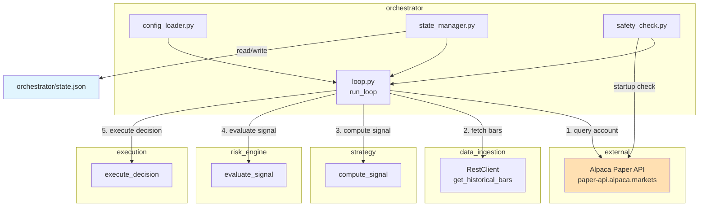

# Design Document: Orchestrator

## Overview

The Orchestrator is the fifth and final module in the Minions paper-trading pipeline. It ties together the four existing modules (Data Ingestion → Strategy Engine → Risk Engine → Execution) into a continuous, unattended loop. Rather than executing on a fixed clock, it anchors its schedule to the availability of new daily bars — running a pipeline cycle only when there is genuinely new data to act on.

### Design Goals

- **Correctness**: The integrated pipeline must produce the same decisions as manually invoking each module in sequence.
- **Safety**: Hard-coded paper-trading enforcement. Post-order failures halt immediately to prevent ambiguous positions. A startup safety check flags unprotected positions.
- **Durability**: A local state file records positions opened by the Orchestrator and persists scheduling state, surviving restarts.
- **Resilience**: Pre-order failures (data fetch, strategy, risk engine) are retried on the next cycle. Only post-order ambiguity halts the loop.
- **Explicitness**: Well-commented, readable code for a developer experienced in C++ but new to Python.

### Key Design Decisions

1. **Fresh-query every cycle**: Account and position state is always queried from Alpaca at the start of each cycle — never cached locally between cycles. This eliminates stale-state bugs at the cost of one extra API call per cycle (acceptable for a daily-bar bot).
2. **Event-anchored scheduling**: The loop polls for new daily bars rather than running on a fixed timer. This means zero wasted cycles on weekends/holidays and no race conditions with partial bar data.
3. **Severity-split error handling**: Pre-order failures are safe to retry (no money at risk). Post-order failures or raw exceptions from Execution halt immediately (order state is ambiguous).
4. **Single shared polling interval**: We use `bar_check_interval_seconds` for both new-bar checks and market-open polling rather than introducing a second configurable interval. This is an accepted tradeoff, not a neutral simplification: a deferred order could wait up to the full configured interval (up to 60 minutes at the top of the allowed range) after market open before the Orchestrator notices and submits it. For this paper-trading bot's purposes — where the deferred-execution scenario itself is already an edge case (same-day close-to-open gap) and precise fill timing isn't a stated requirement — this delay is acceptable. If tighter market-open responsiveness is needed in the future, a separate `market_open_check_interval_seconds` config key can be added without other structural changes.
5. **Atomic state file writes**: Write-to-temp-then-rename prevents corruption if the process is killed mid-write.
6. **Deferred execution with persistence**: When the market is closed, the computed Decision_Dict is persisted to the state file (not held only in memory) so it survives crashes during the wait period.
7. **Alpaca Clock endpoint for market-open checks**: The `TradingClient.get_clock()` method returns `is_open` (bool), `timestamp`, `next_open`, and `next_close` — confirmed available for paper trading accounts via the same credentials.

### Research Findings

- **Alpaca Clock API**: `TradingClient.get_clock()` returns a `Clock` object with attributes: `is_open` (bool), `timestamp` (datetime), `next_open` (datetime), `next_close` (datetime). Available for paper trading. [Source: Alpaca SDK docs](https://alpaca.markets/sdks/python/api_reference/trading/clock.html)
- **Alpaca Account API**: `TradingClient.get_account()` returns a `TradeAccount` object with attributes including `equity`, `cash`, `last_equity`, `buying_power`, `status`. The `last_equity` field is the previous day's closing equity — used to derive daily realized P&L.
- **Alpaca Positions API**: `TradingClient.get_all_positions()` returns a list of `Position` objects with `symbol`, `qty` (string, may be fractional), `current_price`, `unrealized_pl`, `side`.
- **Alpaca Orders API**: `TradingClient.get_orders(filter)` returns orders with `type`, `symbol`, `side`, `status` — used in the safety check to find active stop-loss orders.

---

## Architecture



### Module Boundary

| Boundary | Direction | Data Shape |
|----------|-----------|-----------|
| Alpaca → `orchestrator` | Input | `TradeAccount`, `Position[]`, `Clock`, `Order[]` |
| `orchestrator` → `data_ingestion` | Call | `RestClient.get_historical_bars(symbol, "1d", start, end)` → DataFrame |
| `orchestrator` → `strategy` | Call | `compute_signal(df, config, symbol=symbol)` → Signal_Dict |
| `orchestrator` → `risk_engine` | Call | `evaluate_signal(signal_dict, current_price, account_snapshot, config)` → Decision_Dict |
| `orchestrator` → `execution` | Call | `execute_decision(decision_dict, config)` → Order_Result |
| `orchestrator` ↔ State_File | I/O | JSON with `positions`, `last_acted_bar`, `pending_decision` |
| `orchestrator/config.yaml` → `orchestrator` | Config | YAML with `bar_check_interval_seconds`, `symbol`, `state_file_path` |

### Separation of Concerns

- **`config_loader.py`** — Reads and validates `orchestrator/config.yaml`. Only YAML I/O in the module.
- **`state_manager.py`** — All logic for reading, writing, and updating the State_File (Position_Records, Last_Acted_Bar, pending_decision). Atomic writes.
- **`safety_check.py`** — Startup safety check: cross-references positions against stop-loss orders.
- **`loop.py`** — Main loop: new-bar checking, cycle execution, error classification, shutdown handling, deferred execution.
- **`__init__.py`** — Public API surface.

---

## Components and Interfaces

### 1. `orchestrator/config_loader.py`

```python
from dataclasses import dataclass

@dataclass
class OrchestratorConfig:
    """Validated configuration for the orchestrator module."""
    bar_check_interval_seconds: float  # [60, 3600] — polling interval
    symbol: str                         # 1–10 chars, default "AAPL"
    state_file_path: str                # 1–255 chars, default "orchestrator/state.json"

def load_config(config_path: str) -> OrchestratorConfig:
    """
    Read orchestrator/config.yaml and return a validated OrchestratorConfig.

    Algorithm (mirrors strategy/config_loader.py pattern):
      Step 1 — file existence check       → FileNotFoundError
      Step 2 — YAML parsing               → ValueError on syntax error
      Step 3 — non-dict YAML check        → ValueError if parsed to non-dict
      Step 4 — required key presence check → ValueError listing missing keys
      Step 5 — value type and range check  → ValueError identifying invalid key
      Step 6 — warn on unknown keys        → WARNING log, no error
      Step 7 — apply defaults for optional keys
      Step 8 — return OrchestratorConfig(...)

    Raises:
        FileNotFoundError: config file absent
        ValueError: invalid YAML, non-dict, missing keys, or constraint violations
    """
```

**Validation Rules** (Step 5):

| Key | Required | Type | Constraint | Default |
|-----|----------|------|-----------|---------|
| `bar_check_interval_seconds` | Yes | int or float (not bool) | 60 ≤ value ≤ 3600 | — |
| `symbol` | No | str | 1–10 characters, non-empty | `"AAPL"` |
| `state_file_path` | No | str | 1–255 characters, non-empty | `"orchestrator/state.json"` |

Booleans are explicitly rejected for the numeric field.

### 2. `orchestrator/state_manager.py`

```python
import json
import os
import tempfile
from dataclasses import dataclass, field
from typing import Optional

@dataclass
class PositionRecord:
    """A durable record of a position opened by the Orchestrator."""
    symbol: str                    # Ticker (e.g., "AAPL")
    entry_order_id: str            # Alpaca order ID
    stop_loss_order_id: Optional[str]  # Alpaca stop-loss order ID or None
    quantity: int                   # Shares held (≥ 1)
    entry_price: float             # Fill price, rounded to 2 decimal places
    entry_timestamp: str           # UTC ISO 8601 string
    status: str                    # "open", "closed", or "partially_closed"
    exit_timestamp: Optional[str] = None  # UTC ISO 8601 string, set on close

@dataclass
class StateData:
    """The complete content of the State_File."""
    positions: list                 # List of PositionRecord dicts
    last_acted_bar: Optional[str]   # UTC ISO 8601 string or None
    pending_decision: Optional[dict] = None  # Serialized Decision_Dict or None


def load_state(state_file_path: str) -> StateData:
    """
    Load the State_File from disk.

    If the file does not exist, creates and returns an empty StateData.
    If the file exists but contains invalid JSON, raises ValueError.

    Args:
        state_file_path: Path to the state.json file.

    Returns:
        Populated StateData instance.

    Raises:
        ValueError: If the file contains invalid JSON.
    """


def save_state(state_data: StateData, state_file_path: str) -> None:
    """
    Atomically write the StateData to disk.

    Algorithm:
      1. Serialize StateData to JSON with indent=2.
      2. Write to a temporary file in the same directory as state_file_path.
      3. os.replace() the temp file over the target (atomic on most OS).

    Args:
        state_data: The StateData to persist.
        state_file_path: Target file path.

    Raises:
        OSError: If the write or rename fails (disk full, permissions, etc.).
    """


def add_position_record(
    state_data: StateData,
    order_result: dict,
    symbol: str,
) -> StateData:
    """
    Append a new open PositionRecord from a filled/partial_fill BUY Order_Result.

    Returns a new StateData with the appended record (does not mutate input).
    """


def update_position_on_sell(
    state_data: StateData,
    order_result: dict,
    symbol: str,
) -> StateData:
    """
    Update an existing open PositionRecord based on a SELL Order_Result.

    - If status is "filled": set status to "closed", record exit_timestamp.
    - If status is "partial_fill": decrement quantity by filled_quantity.
      If remaining quantity is 0, set status to "closed".
      Otherwise, set status to "partially_closed".

    Returns a new StateData (does not mutate input).
    """


def format_account_snapshot(
    account,
    positions: list,
) -> dict:
    """
    Transform Alpaca TradeAccount and Position objects into the
    Risk Engine's expected account_snapshot format.

    Algorithm:
      1. Extract equity = float(account.equity).
         If equity <= 0, raise ValueError (cycle should be skipped).
      2. Extract cash = float(account.cash).
         If cash < 0, raise ValueError (cycle should be skipped and retried,
         same as the equity <= 0 case in step 1).
      3. Compute daily_realized_pnl = float(account.equity) - float(account.last_equity).
      4. Build open_positions list:
         For each position in positions:
           - symbol = position.symbol
           - size = int(float(position.qty))  # truncate fractional to integer
           - If size <= 0, skip this position
           - Append {"symbol": symbol, "size": size}
      5. Return {"equity": equity, "cash": cash,
                 "open_positions": open_positions,
                 "daily_realized_pnl": daily_realized_pnl}

    Args:
        account: Alpaca TradeAccount object.
        positions: List of Alpaca Position objects.

    Returns:
        account_snapshot dict compatible with Risk Engine.

    Raises:
        ValueError: If equity is zero or negative, or if cash is negative.
    """
```

### 3. `orchestrator/safety_check.py`

```python
import logging

logger = logging.getLogger("orchestrator")


def run_safety_check(client) -> dict:
    """
    Cross-reference all open positions against open stop-loss orders.

    Algorithm:
      1. Query all open positions via client.get_all_positions().
      2. Query all open orders via client.get_orders(filter=GetOrdersRequest(
             status="open")).
      3. For each position:
         - Determine if it's long (qty > 0) or short (qty < 0).
         - Search open orders for a matching stop-loss:
           type in ("stop", "stop_limit") AND
           symbol matches AND
           side is "sell" for long / "buy" for short.
         - If no match found → log CRITICAL with position details.
      4. Log INFO summary: total positions checked, count unprotected.
      5. Return {"total_positions": N, "unprotected_count": M}.

    If Alpaca API fails (timeout, HTTP error), raises the exception
    (caller handles it by logging CRITICAL and halting startup).

    Args:
        client: Alpaca TradingClient (paper).

    Returns:
        dict with total_positions and unprotected_count.

    Raises:
        Exception: If Alpaca API call fails.
    """
```

### 4. `orchestrator/loop.py`

```python
import logging
import signal
import sys
import time
import threading
from datetime import datetime, timezone, timedelta

import pandas as pd

from data_ingestion import RestClient
from data_ingestion.credentials import load_credentials
from strategy import compute_signal, load_config as load_strategy_config
from risk_engine import evaluate_signal, load_config as load_risk_config
from execution import execute_decision, load_config as load_execution_config

from alpaca.trading.client import TradingClient

from orchestrator.config_loader import OrchestratorConfig, load_config
from orchestrator.state_manager import (
    load_state, save_state, add_position_record,
    update_position_on_sell, format_account_snapshot, StateData,
)
from orchestrator.safety_check import run_safety_check

logger = logging.getLogger("orchestrator")


def run_loop(config_path: str = "orchestrator/config.yaml") -> None:
    """
    Main entry point for the Orchestrator. Runs the trading loop.

    Implementation note — interruptible idle wait:
      The idle wait between new-bar checks uses a threading.Event rather than
      time.sleep(). The signal handler calls event.set() when SIGINT/SIGTERM
      arrives, which immediately unblocks event.wait(timeout). This satisfies
      Requirement 4.6's 2-second shutdown target when idle, without needing
      to poll a flag in a tight loop.

    High-level algorithm:
      Phase 1 — Initialization:
        1. Load orchestrator config.
        2. Load credentials, create TradingClient (paper=True, verified).
        3. Create RestClient for data ingestion.
        4. Load strategy, risk, execution configs.
        5. Load or create state file.
        6. Check for pending deferred decision (resume if found).
        7. Run safety check.
        8. Register signal handlers (SIGINT, SIGTERM).

      Phase 2 — Main Loop:
        9. Check stop_flag → exit if set.
        10. If holding deferred decision:
            - Check market open → execute if open.
            - Sleep and recheck.
        11. Check for new daily bar.
            - If no new bar → sleep, go to step 9.
            - If new bar → run cycle.
        12. Run cycle:
            a. Query account state.
            b. Data Ingestion.
            c. Strategy.
            d. Risk Engine.
            e. Check market open (if not open, defer execution).
            f. Execution.
            g. Record outcome, update state.
        13. Handle errors (classify, log, continue or halt).
        14. Go to step 9.

      Phase 3 — Shutdown:
        15. Flush state file.
        16. Log shutdown_completed.
        17. Exit with appropriate code.

    Args:
        config_path: Path to orchestrator/config.yaml.

    Returns:
        None (exits the process via sys.exit).
    """


def _create_paper_client(api_key: str, secret_key: str) -> TradingClient:
    """
    Instantiate Alpaca TradingClient with hard-coded paper=True.

    Verifies the base URL contains "paper" (case-insensitive).
    Raises RuntimeError if safety check fails.
    """


def _check_new_bar(
    rest_client,
    symbol: str,
    last_acted_bar: str | None,
) -> tuple[bool, str | None]:
    """
    Check if a new daily bar is available.

    Fetches the latest daily bar for the symbol.
    Compares its date (YYYY-MM-DD UTC) against last_acted_bar.

    Returns:
        (is_new, bar_timestamp) where:
        - is_new = True if bar is newer than last_acted_bar (or last_acted_bar is None)
        - bar_timestamp = ISO 8601 string of the latest bar's date
    """


def _run_cycle(
    rest_client,
    trading_client: TradingClient,
    strategy_config,
    risk_config,
    execution_config,
    orch_config: OrchestratorConfig,
    state_data: StateData,
    cycle_number: int,
) -> tuple[str, dict | None]:
    """
    Execute one complete pipeline cycle.

    Returns:
        (outcome, order_result) where outcome is one of:
        "filled", "partial_fill", "vetoed", "no_action", "skipped",
        "cancelled", "expired", "rejected", "timeout",
        "deferred" (market closed — execution deferred).

        order_result is the Order_Result dict (or None for vetoed/no_action/deferred).
    """


def _classify_error(
    stage: str,
    error: Exception,
    order_result: dict | None,
) -> str:
    """
    Classify an error as "pre_order" (safe to retry) or "post_order" (halt).

    Rules:
      - Errors in account_query, data_ingestion, strategy, risk_engine → "pre_order"
      - Execution returns Order_Result with status="error" and entry_order_id=None → "pre_order"
      - Execution returns Order_Result with status="error" and entry_order_id!=None → "post_order"
      - Raw exception from Execution (no Order_Result) → "post_order"
      - A pipeline stage returning an unexpected type or None where a valid
        output is required (per Requirement 3.2) → "post_order" (halt the loop).
        This indicates an internal contract violation between stages, not a
        transient external failure — retrying will not fix it.

    Returns:
        "pre_order" or "post_order"
    """
```

### 5. `orchestrator/__init__.py`

```python
"""
orchestrator/ — Pipeline Orchestrator for the Minions paper-trading bot.

LIVE TRADING IS FORBIDDEN. This module instantiates the Alpaca TradingClient
with paper=True as a HARD-CODED LITERAL. No configuration parameter,
environment variable, or code path may route to a live trading account.
"""

from orchestrator.config_loader import OrchestratorConfig, load_config
from orchestrator.loop import run_loop

__all__ = ["OrchestratorConfig", "load_config", "run_loop"]
```

### 6. `orchestrator/config.yaml`

```yaml
# orchestrator/config.yaml
# ========================
# Configuration for the Pipeline Orchestrator module.

# bar_check_interval_seconds: How frequently (in seconds) to poll for
# a new daily bar. Also used as the recheck interval when waiting for
# market open during deferred execution.
# Type: int or float, range: [60, 3600]. REQUIRED — no default.
bar_check_interval_seconds: 300

# symbol: The ticker symbol to trade. Must be a non-empty string of
# 1–10 characters.
# Type: string, default: "AAPL". OPTIONAL.
# symbol: "AAPL"

# state_file_path: Relative or absolute path to the durable state file.
# Must be a non-empty string of 1–255 characters.
# Type: string, default: "orchestrator/state.json". OPTIONAL.
# state_file_path: "orchestrator/state.json"
```

---

## Data Models

### State_File Schema (`orchestrator/state.json`)

```json
{
  "positions": [
    {
      "symbol": "AAPL",
      "entry_order_id": "abc-123-def",
      "stop_loss_order_id": "xyz-456-ghi",
      "quantity": 10,
      "entry_price": 150.25,
      "entry_timestamp": "2024-06-15T14:30:00Z",
      "status": "open",
      "exit_timestamp": null
    }
  ],
  "last_acted_bar": "2024-06-15T00:00:00Z",
  "pending_decision": null
}
```

### Account_Snapshot (internal, passed to Risk Engine)

```python
{
    "equity": float,              # Positive — total account value
    "cash": float,                # Non-negative — available cash
    "open_positions": [           # List of position dicts
        {"symbol": str, "size": int},  # size = truncated-to-int shares
    ],
    "daily_realized_pnl": float,  # equity - last_equity
}
```

### OrchestratorConfig

```python
@dataclass
class OrchestratorConfig:
    bar_check_interval_seconds: float  # [60, 3600]
    symbol: str                         # 1–10 chars, default "AAPL"
    state_file_path: str                # 1–255 chars, default "orchestrator/state.json"
```

### Position_Record

```python
@dataclass
class PositionRecord:
    symbol: str                     # Ticker
    entry_order_id: str             # Alpaca order ID
    stop_loss_order_id: str | None  # Stop-loss order ID or None
    quantity: int                    # Shares (≥ 1)
    entry_price: float              # Rounded to 2 decimals
    entry_timestamp: str            # UTC ISO 8601
    status: str                     # "open" | "closed" | "partially_closed"
    exit_timestamp: str | None      # UTC ISO 8601 or None
```

### Cycle Outcome Classification

| Outcome | Source | Meaning | Updates Last_Acted_Bar |
|---------|--------|---------|----------------------|
| `"filled"` | Execution | Order fully filled | Yes |
| `"partial_fill"` | Execution | Order partially filled | Yes |
| `"skipped"` | Execution | Non-approved decision | Yes |
| `"cancelled"` | Execution | Order cancelled | Yes |
| `"expired"` | Execution | Order expired | Yes |
| `"rejected"` | Execution | Order rejected | Yes |
| `"timeout"` | Execution | Fill timed out, order cancelled | Yes |
| `"vetoed"` | Risk Engine | Signal vetoed | Yes |
| `"no_action"` | Risk Engine | HOLD → NO_ACTION | Yes |
| `"deferred"` | Market closed | Awaiting market open | No (until resolved) |

---

## Correctness Properties

*A property is a characteristic or behavior that should hold true across all valid executions of a system — essentially, a formal statement about what the system should do. Properties serve as the bridge between human-readable specifications and machine-verifiable correctness guarantees.*

### Property 1: Account snapshot formatting preserves data and conforms to schema

*For any* Alpaca TradeAccount with positive equity and non-negative cash, and any list of Position objects (with varying symbols, fractional quantities, and prices), the `format_account_snapshot` function SHALL return a dictionary where: `equity` equals `float(account.equity)`, `cash` equals `float(account.cash)`, `daily_realized_pnl` equals `float(account.equity) - float(account.last_equity)`, and `open_positions` contains one entry per position whose truncated quantity is ≥ 1, with each entry having `symbol` as a string and `size` as `int(float(position.qty))`. IF `cash` is negative, the function SHALL raise `ValueError` (same behavior as the equity ≤ 0 check).

**Validates: Requirements 1.2, 1.5**

### Property 2: New bar detection is a strict date comparison

*For any* pair of UTC date strings (latest_bar_date, last_acted_bar_date), the new-bar detection function SHALL return `True` if and only if the date portion (YYYY-MM-DD) of latest_bar_date is strictly greater than the date portion of last_acted_bar_date. When last_acted_bar is `None`, the function SHALL always return `True`.

**Validates: Requirements 2.1, 2.2, 2.3, 2.5**

### Property 3: Config validation accepts valid values and rejects invalid ones

*For any* configuration dictionary: if `bar_check_interval_seconds` is a number in [60, 3600] (not bool), `symbol` (if present) is a string of 1–10 characters, and `state_file_path` (if present) is a string of 1–255 characters, then `load_config` SHALL return a valid `OrchestratorConfig`. If any value violates its constraint, `load_config` SHALL raise `ValueError` identifying the invalid key.

**Validates: Requirements 8.2, 8.6, 8.7**

### Property 4: State file round-trip serialization

*For any* valid StateData (containing a list of PositionRecords, a `last_acted_bar` string or None, and a `pending_decision` dict or None), serializing to JSON and deserializing SHALL produce an equivalent StateData — all fields preserved without loss or corruption.

**Validates: Requirements 2.12, 6.7**

### Property 5: Error classification based on entry_order_id and contract violations

*For any* Order_Result with `status` equal to `"error"`: if `entry_order_id` is not `None` (order was submitted), the error SHALL be classified as `"post_order"` (halt the loop). If `entry_order_id` is `None` (no order was submitted), the error SHALL be classified as `"pre_order"` (skip cycle, continue). A raw exception from the Execution module (no Order_Result returned) SHALL always be classified as `"post_order"`. Additionally, if any pipeline stage returns an unexpected type or `None` where a valid output is required (per Requirement 3.2), the error SHALL be classified as `"post_order"` (halt the loop) — this is an internal contract violation, not a transient external failure, and retrying cannot fix it.

**Validates: Requirements 3.2, 5.3, 5.4, 5.8**

### Property 6: Correct declines never trigger halt or error log

*For any* pipeline outcome where the Risk Engine returns `decision` equal to `"VETOED"` or `"NO_ACTION"`, or the Execution module returns `status` equal to `"skipped"`, the Orchestrator SHALL NOT log at ERROR or CRITICAL level and SHALL NOT halt the main loop — the cycle SHALL be considered complete.

**Validates: Requirements 5.7**

### Property 7: Consecutive failure escalation at threshold

*For any* sequence of cycle outcomes where N ≥ 3 consecutive cycles are skipped due to pre-order failures, the 3rd and subsequent consecutive failures SHALL be logged at ERROR level (escalated from WARNING). After any successful cycle completion, the consecutive failure counter SHALL reset to zero, and the next failure SHALL be logged at WARNING level.

**Validates: Requirements 5.9**

### Property 8: Position record creation on BUY fill

*For any* Order_Result with `status` in `{"filled", "partial_fill"}` for a BUY signal, the resulting PositionRecord SHALL contain: `symbol` matching the configured symbol, `entry_order_id` matching the Order_Result, `stop_loss_order_id` from the Order_Result (or None), `quantity` equal to the `filled_quantity`, `entry_price` equal to `round(fill_price, 2)`, `entry_timestamp` as a UTC ISO 8601 string, and `status` equal to `"open"`.

**Validates: Requirements 6.2**

### Property 9: Position record update on SELL

*For any* existing open PositionRecord and a SELL Order_Result: if `status` is `"filled"`, the record's status SHALL become `"closed"` with `exit_timestamp` set. If `status` is `"partial_fill"`, the record's `quantity` SHALL decrease by `filled_quantity`; if the resulting quantity is zero, status SHALL be `"closed"` with `exit_timestamp`; otherwise status SHALL be `"partially_closed"`.

**Validates: Requirements 6.3**

### Property 10: Safety check correctly identifies unprotected positions

*For any* set of open positions and open orders: a position is "protected" if and only if there exists an order with `type` in `{"stop", "stop_limit"}`, matching `symbol`, and `side` equal to `"sell"` for a long position (positive qty) or `"buy"` for a short position (negative qty). The safety check SHALL identify exactly the set of positions that lack a matching protective order.

**Validates: Requirements 7.2, 7.3**

### Property 11: Current price extraction from DataFrame

*For any* valid Bar DataFrame with at least one row, the `current_price` passed to `evaluate_signal` SHALL equal the `close` value of the last row (i.e., `df["close"].iloc[-1]`).

**Validates: Requirements 3.3**

---

## Error Handling

### Error Classification Matrix

| Stage | Error Type | Severity | Action |
|-------|-----------|----------|--------|
| Account query | API timeout, HTTP error, equity ≤ 0, cash < 0 | WARNING | Skip cycle, continue |
| Data Ingestion | Network error, invalid response | WARNING | Skip cycle, continue |
| Strategy | Unexpected exception | WARNING | Skip cycle, continue |
| Risk Engine | Unexpected exception (not a veto) | WARNING | Skip cycle, continue |
| Execution | Order_Result status="error", entry_order_id=None | WARNING | Skip cycle, continue |
| Execution | Order_Result status="error", entry_order_id≠None | CRITICAL | Halt loop, exit non-zero |
| Execution | Raw exception (no Order_Result) | CRITICAL | Halt loop, exit non-zero |
| Any stage | Unexpected return type or None (contract violation) | CRITICAL | Halt loop, exit non-zero |
| State file | Write failure (disk full, permissions) | CRITICAL | Halt loop, exit non-zero |
| Safety check | API failure on startup | CRITICAL | Halt startup, exit non-zero |

### Error Escalation

After 3 consecutive pre-order failures (cycles skipped), the log level escalates from WARNING to ERROR. The counter resets to zero on any successful cycle.

### Structured Log Events

All log events use JSON format via Python's `logging` module with logger name `"orchestrator"`:

| Event | Level | Key Fields |
|-------|-------|-----------|
| `cycle_started` | INFO | cycle_number, bar_timestamp, equity |
| `cycle_completed` | INFO | cycle_number, outcome, symbol |
| `cycle_skipped` | WARNING/ERROR | error_type, error_message, pipeline_stage |
| `loop_halted` | CRITICAL | entry_order_id, symbol, error_details, cycle_number |
| `shutdown_initiated` | INFO | signal, cycle_in_progress |
| `shutdown_completed` | INFO | — |
| `new_bar_detected` | DEBUG | bar_timestamp, previous_last_acted_bar |
| `safety_check_completed` | INFO | total_positions, unprotected_count |
| `safety_check_failed` | CRITICAL | error_details |
| `unprotected_position_detected` | CRITICAL | symbol, quantity, market_value |
| `duplicate_shutdown_signal` | WARNING | signal_name |
| `shutdown_cycle_timeout_warning` | WARNING | elapsed_seconds |

### Graceful Shutdown Sequence

1. Signal handler sets `stop_flag = True`.
2. If sleeping between checks → attempt to interrupt the sleep (the idle wait uses a `threading.Event().wait(timeout)` pattern rather than `time.sleep()`, so the wait can be woken early by the signal handler calling `event.set()`). If the interrupt does not fire within 2 seconds, log a WARNING-level event and continue waiting — the next natural loop iteration will pick up the stop_flag. The Orchestrator SHALL NOT force-terminate even if the interrupt fails; it always waits for a clean checkpoint.
3. If cycle in progress → wait for completion (log warning if > 300s).
4. If holding deferred decision → discard it, clear from state file, log WARNING.
5. Flush state file atomically.
6. Log `shutdown_completed`.
7. `sys.exit(0)`.

### Halt Sequence (Post-Order Failure)

1. Log CRITICAL with `loop_halted` event (includes entry_order_id, symbol).
2. Flush state file atomically.
3. `sys.exit(1)`.

---

## Testing Strategy

### Testing Framework

- **pytest** — test runner (already in `requirements.txt`)
- **Hypothesis** — property-based testing library (already in `requirements.txt`)
- **unittest.mock** — for mocking Alpaca API calls and module functions

### Dual Testing Approach

#### Property-Based Tests (Hypothesis)

Each correctness property maps to one property-based test function, configured with `@settings(max_examples=100)` minimum. Tests are tagged with comments referencing the design property:

```python
# Feature: orchestrator, Property 1: Account snapshot formatting preserves data and conforms to schema
```

Properties 1–11 from the Correctness Properties section above will each be implemented as a single Hypothesis property test.

**Generator strategies needed:**

```python
def mock_alpaca_account(min_equity=0.01, max_equity=1_000_000):
    """Generate mock Alpaca TradeAccount with random equity, cash, last_equity."""

def mock_alpaca_positions(min_count=0, max_count=10):
    """Generate list of mock Position objects with varying symbols and fractional qtys."""

def valid_date_pair():
    """Generate pairs of (latest_bar_date, last_acted_bar_date) as ISO strings."""

def valid_orchestrator_config_dict():
    """Generate valid config dicts with bar_check_interval_seconds in [60, 3600]."""

def invalid_orchestrator_config_dict():
    """Generate config dicts with one invalid field."""

def valid_state_data():
    """Generate valid StateData with random positions and last_acted_bar."""

def valid_decision_dict_for_serialization():
    """Generate valid Decision_Dicts for state file serialization testing."""

def valid_order_result_error(with_order_id: bool):
    """Generate Order_Results with status='error' and varying entry_order_id."""

def correct_decline_outcomes():
    """Generate Risk Engine vetoes, NO_ACTION, and Execution 'skipped' results."""

def valid_bar_dataframe(min_rows=1, max_rows=50):
    """Generate DataFrames with OHLCV data for current price extraction."""

def mock_positions_and_orders():
    """Generate sets of positions and stop-loss orders for safety check testing."""

def valid_buy_order_result():
    """Generate filled/partial_fill Order_Results for BUY signals."""

def valid_sell_order_result():
    """Generate filled/partial_fill Order_Results for SELL signals."""
```

#### Unit Tests (Example-Based)

Targeted tests for scenarios not well-covered by property tests:

**Config Loader:**
- `test_config_file_not_found` — FileNotFoundError with path in message
- `test_config_invalid_yaml` — ValueError on malformed YAML
- `test_config_non_dict_yaml` — ValueError on YAML list
- `test_config_missing_required_key` — ValueError naming missing key
- `test_config_unknown_keys_warning` — WARNING logged, no error
- `test_config_defaults_applied` — symbol and state_file_path use defaults

**State Manager:**
- `test_state_file_created_on_first_run` — empty state file created
- `test_state_file_invalid_json_raises` — ValueError on corrupt file
- `test_atomic_write_uses_rename` — verify temp-then-rename pattern
- `test_pending_decision_persistence` — Decision_Dict survives write/read

**Safety Check:**
- `test_all_positions_protected` — no CRITICAL logs
- `test_unprotected_position_logged` — CRITICAL for each unprotected
- `test_safety_check_api_failure_halts` — exception propagates
- `test_pre_existing_positions_included` — positions without records still checked

**Loop:**
- `test_first_run_triggers_cycle` — no last_acted_bar → cycle runs
- `test_same_bar_no_cycle` — same bar date → idle
- `test_market_closed_defers_execution` — decision persisted, execution deferred
- `test_deferred_executes_on_market_open` — same decision used when market opens
- `test_startup_resumes_pending_decision` — Orchestrator starts with a non-null pending_decision in the state file (simulating a restart after a crash during deferred execution); verify a WARNING is logged identifying the pending decision, and the Orchestrator resumes waiting for market open to execute the same Decision_Dict rather than discarding it or recomputing a new signal
- `test_shutdown_during_deferred_discards` — pending decision cleared
- `test_shutdown_signal_sets_flag` — SIGINT/SIGTERM set stop_flag
- `test_shutdown_between_cycles` — clean exit with code 0
- `test_double_signal_continues_waiting` — WARNING logged, no force-terminate
- `test_pre_order_failure_skips_and_continues` — cycle skipped, loop continues
- `test_post_order_failure_halts` — CRITICAL, state flushed, exit 1
- `test_raw_execution_exception_halts` — treated as post-order failure
- `test_stage_returns_none_halts` — contract violation halts loop (not retried)
- `test_consecutive_failure_escalation` — ERROR at 3rd consecutive, resets on success
- `test_vetoed_is_correct_decline` — no error log, cycle complete
- `test_skipped_is_correct_decline` — no error log, cycle complete
- `test_paper_safety_verified` — RuntimeError if URL lacks "paper"
- `test_credential_error_propagates` — EnvironmentError propagates unchanged

**Integration:**
- `test_full_cycle_buy_filled` — end-to-end with all mocked modules
- `test_full_cycle_sell_filled` — end-to-end sell cycle
- `test_pipeline_invocation_order` — verify strict stage ordering

#### Static Analysis / Smoke Tests

- `test_paper_true_ast_scan` — AST scan of `orchestrator/` verifying `paper=True` is a literal in all `TradingClient` instantiations
- `test_no_direct_env_reading` — AST scan verifying `orchestrator/` does not import `dotenv` or read `.env` directly
- `test_no_live_trading_config` — verify no config key for paper/live mode selection

### Test File Organization

```
tests/
├── test_orchestrator_properties.py   # Property-based tests (Properties 1–11)
├── test_orchestrator_unit.py         # Example-based unit tests
└── test_orchestrator_purity.py       # AST-scan smoke tests
```

### Property Test Configuration

- Minimum 100 iterations per property test (`@settings(max_examples=100)`)
- Each test tagged: `Feature: orchestrator, Property {N}: {title}`
- Mock objects used for Alpaca API (no real API calls in property tests)
- Account generators use equity range [0.01, 1,000,000] for realistic values
- Position generators capped at 10 positions for test performance
- Date generators span 2020-01-01 to 2025-12-31 for variety
