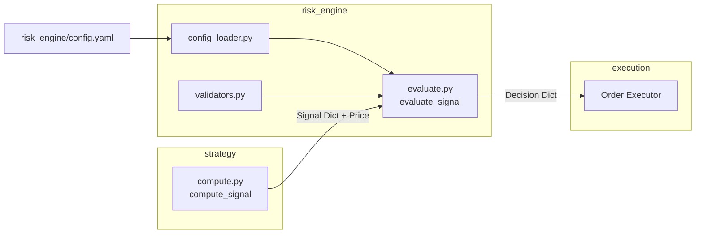

# Design Document: Risk Engine

## Overview

The Risk Engine is the third stage in the Minions paper-trading pipeline. It receives a signal dictionary from the `strategy` module, a current market price, and an account snapshot (equity, cash, open positions, daily P&L) as function parameters. It applies four configurable guardrails — max position size, max daily loss, max open positions, and mandatory stop-loss — and returns either an approved order (with computed size and stop-loss) or a rejection with a reason. The Risk Engine NEVER places orders; it only renders a decision for the downstream execution module to act on.

### Design Goals

- **Purity**: Zero side effects during signal evaluation — no network, no file I/O, no mutable global state during `evaluate_signal()`.
- **Determinism**: Same inputs always produce the same outputs.
- **Statelessness**: All state (daily P&L, positions, equity) is passed in by the caller — no module-level mutable state.
- **Explicitness**: Well-commented, readable code appropriate for a developer experienced in C++ but new to Python.
- **Testability**: Pure functions with clear input/output contracts enable comprehensive property-based testing with Hypothesis.

### Key Design Decisions

1. **Functional core, imperative shell**: `evaluate_signal()` is a pure function. Configuration loading is the only I/O and happens once at initialization, before any signal evaluation.
2. **Mirrors the strategy module structure**: Same file layout (`config_loader.py`, `validators.py`, `evaluate.py`, `__init__.py`, `config.yaml`) for consistency and developer familiarity.
3. **No class inheritance hierarchy**: A single `RiskConfig` dataclass for configuration and a single public function `evaluate_signal()` as the entry point.
4. **Strict check ordering**: Risk checks execute in a defined priority order (daily loss → open positions/position-held → position sizing → stop-loss) so that the reason for any veto is unambiguous.
5. **Hypothesis for property-based testing**: Consistent with the existing test infrastructure in `tests/test_strategy_properties.py`.

---

## Architecture



### Module Boundary

| Boundary | Direction | Data Shape |
|----------|-----------|-----------|
| `strategy` → `risk_engine` | Input | `dict` (Signal_Dict) with keys: `signal`, `short_sma`, `long_sma`, `timestamp`, optional `symbol` |
| caller → `risk_engine` | Input | `current_price` (positive float), `account_snapshot` (dict with `equity`, `cash`, `open_positions`, `daily_realized_pnl`) |
| `risk_engine` → `execution` | Output | `dict` (Decision_Dict) with keys: `decision`, `signal`, `position_size`, `stop_loss`, `reason`, `timestamp`, optional `symbol` |
| `risk_engine/config.yaml` → `risk_engine` | Config (init only) | YAML with `max_position_percent`, `max_daily_loss`, `max_open_positions`, `stop_loss_percent` |

### Separation of Concerns

- **`config_loader.py`** — Reads and validates `risk_engine/config.yaml`. Only file I/O in the module.
- **`validators.py`** — Input validation for `signal_dict`, `current_price`, and `account_snapshot`. Pure logic, no I/O.
- **`evaluate.py`** — Contains `evaluate_signal()`. Pure computation: applies risk checks in defined order, computes position size and stop-loss. No imports of networking or I/O libraries.
- **`__init__.py`** — Public API surface. Re-exports `evaluate_signal`, `load_config`, and `RiskConfig`.

---

## Components and Interfaces

### 1. `risk_engine/config_loader.py`

```python
from dataclasses import dataclass

@dataclass
class RiskConfig:
    """Validated configuration for the risk engine module."""
    max_position_percent: float  # (0, 100) exclusive — max % of equity per trade
    max_daily_loss: float        # positive float — max realized loss in USD per day
    max_open_positions: int      # [1, 1000] — max concurrent open positions
    stop_loss_percent: float     # (0, 100) exclusive — % distance for stop-loss

def load_config(config_path: str) -> RiskConfig:
    """
    Read risk_engine/config.yaml and return a validated RiskConfig.

    Algorithm (mirrors strategy/config_loader.py pattern):
      Step 1 — file existence check       → FileNotFoundError
      Step 2 — YAML parsing               → ValueError on syntax error
      Step 3 — non-dict YAML check        → ValueError if parsed to non-dict
      Step 4 — required key presence check → ValueError listing missing keys
      Step 5 — value type and range check  → ValueError identifying invalid key
      Step 6 — return RiskConfig(...)

    Raises:
        FileNotFoundError: config file absent
        ValueError: invalid YAML, non-dict, missing keys, or constraint violations
    """
```

**Validation Rules** (Step 5):

| Key | Type | Constraint |
|-----|------|-----------|
| `max_position_percent` | float (not bool) | 0 < value < 100 |
| `max_daily_loss` | float or int (not bool) | value > 0 |
| `max_open_positions` | int (not bool) | 1 ≤ value ≤ 1000 |
| `stop_loss_percent` | float (not bool) | 0 < value < 100 |

Booleans are explicitly rejected for all numeric fields (Python quirk: `bool` is a subclass of `int`).

### 2. `risk_engine/validators.py`

```python
import pandas as pd

def validate_signal_dict(signal_dict) -> None:
    """
    Validate the signal dictionary from the strategy module.

    Checks (in order — fail-fast):
      1. signal_dict is a dict (not None or other type) → TypeError
      2. Contains 'signal' key with value in {"BUY", "SELL", "HOLD"} → ValueError
      3. Contains 'timestamp' key with UTC-aware pandas Timestamp → ValueError
      4. If 'symbol' key present, value is str of 1–10 chars → ValueError

    Raises:
        TypeError: signal_dict is not a dict
        ValueError: missing/invalid keys
    """

def validate_current_price(current_price) -> None:
    """
    Validate that current_price is a positive number.

    Checks:
      1. current_price is int or float (not bool, not None) → ValueError
      2. current_price > 0 → ValueError

    Raises:
        ValueError: current_price is None, non-numeric, or not positive
    """

def validate_account_snapshot(account_snapshot) -> None:
    """
    Validate the account snapshot dictionary.

    Checks (in order — fail-fast):
      1. account_snapshot is a dict (not None) → TypeError
      2. Contains 'equity' key: positive float → ValueError
      3. Contains 'cash' key: non-negative float → ValueError
      4. Contains 'open_positions' key: list of dicts → ValueError
         Each position dict must have 'symbol' (non-empty str) and 'size' (positive int)
      5. Contains 'daily_realized_pnl' key: float → ValueError

    Raises:
        TypeError: account_snapshot is not a dict
        ValueError: missing/invalid keys or values
    """
```

### 3. `risk_engine/evaluate.py`

```python
from risk_engine.config_loader import RiskConfig
from risk_engine.validators import (
    validate_signal_dict,
    validate_current_price,
    validate_account_snapshot,
)
import math  # math.floor for position sizing

def evaluate_signal(
    signal_dict: dict,
    current_price: float,
    account_snapshot: dict,
    config: RiskConfig,
) -> dict:
    """
    Evaluate a trading signal against risk guardrails.

    This function follows a strict validation-then-evaluation pipeline.
    Validation checks run in a defined order — the first failure raises
    immediately (fail-fast).

    Algorithm:
      Step 1  — Validate signal_dict (TypeError or ValueError)
      Step 2  — Validate current_price (ValueError)
      Step 3  — Validate account_snapshot (TypeError or ValueError)
      Step 4  — HOLD pass-through: return NO_ACTION immediately
      Step 5  — Risk Check #1: Daily loss limit
      Step 6  — Risk Check #2: Max open positions (BUY) or position-held (SELL)
      Step 7  — Risk Check #3: Position sizing (BUY) or full position (SELL)
      Step 8  — Risk Check #4: Stop-loss computation and validation
      Step 9  — Build and return APPROVED Decision_Dict

    Args:
        signal_dict:      Signal from strategy module (Signal_Dict).
        current_price:    Current market price (positive number).
        account_snapshot: Account state dict (equity, cash, open_positions, daily_realized_pnl).
        config:           Validated RiskConfig with risk parameters.

    Returns:
        Decision_Dict with keys: decision, signal, position_size, stop_loss,
        reason, timestamp, and optionally symbol.

    Raises:
        TypeError:  If signal_dict or account_snapshot is not a dict.
        ValueError: If any input validation fails.
    """
```

**Algorithm Detail**:

**Step 4 — HOLD Pass-Through**:
```python
if signal_dict["signal"] == "HOLD":
    return {
        "decision": "NO_ACTION",
        "signal": "HOLD",
        "position_size": 0,
        "stop_loss": None,
        "reason": "HOLD signals require no risk evaluation",
        "timestamp": signal_dict["timestamp"],
        # "symbol": signal_dict["symbol"]  — only if present
    }
```

**Step 5 — Daily Loss Limit**:
```python
if account_snapshot["daily_realized_pnl"] <= -config.max_daily_loss:
    return VETOED with reason including pnl and limit values
```

**Step 6 — Max Open Positions (BUY) / Position-Held (SELL)**:
- BUY: If `len(open_positions) >= config.max_open_positions` → VETO
- SELL: If `signal_dict` has no `symbol` key → VETO (symbol required)
- SELL: If `symbol` not found in `open_positions` with `size > 0` → VETO

**Step 7 — Position Sizing**:
- BUY:
  ```python
  max_allowed_capital = equity * (max_position_percent / 100)
  size_from_equity = math.floor(max_allowed_capital / current_price)
  size_from_cash = math.floor(cash / current_price)
  position_size = min(size_from_equity, size_from_cash)
  ```
  If `position_size == 0`: VETO with appropriate reason (equity-percent or cash).
- SELL: `position_size = held_position["size"]` (close full position)

**Step 8 — Stop-Loss Computation**:
- BUY: `stop_loss = round(current_price * (1 - stop_loss_percent / 100), 2)`
  - If `stop_loss <= 0` → VETO
- SELL: `stop_loss = round(current_price * (1 + stop_loss_percent / 100), 2)`
  - Always valid (stop_loss_percent in (0,100) guarantees positive result)

**Step 9 — APPROVED**:
```python
return {
    "decision": "APPROVED",
    "signal": signal_dict["signal"],
    "position_size": position_size,
    "stop_loss": stop_loss,
    "reason": "All risk checks passed",
    "timestamp": signal_dict["timestamp"],
    # "symbol": signal_dict["symbol"]  — only if present
}
```

### 4. `risk_engine/__init__.py`

```python
from risk_engine.config_loader import RiskConfig, load_config
from risk_engine.evaluate import evaluate_signal

__all__ = ["RiskConfig", "load_config", "evaluate_signal"]
```

### 5. `risk_engine/config.yaml`

```yaml
# risk_engine/config.yaml
# =======================
# Configuration for the Risk Engine's guardrails.

# max_position_percent: Maximum percentage of account equity that a
# single trade may represent. Float in range (0, 100) exclusive.
max_position_percent: 5.0

# max_daily_loss: Maximum realized loss in USD allowed in a single
# trading day before all further trades are vetoed. Positive float.
max_daily_loss: 500.0

# max_open_positions: Maximum number of concurrent open positions
# allowed. Positive integer in [1, 1000].
max_open_positions: 5

# stop_loss_percent: Percentage distance from entry price at which
# stop-loss is placed. Float in range (0, 100) exclusive.
stop_loss_percent: 2.0
```

---

## Data Models

### Input: Signal_Dict (from strategy module)

```python
{
    "signal": "BUY" | "SELL" | "HOLD",        # One of three literals
    "short_sma": float | None,                 # Current short SMA (unused by risk engine)
    "long_sma": float | None,                  # Current long SMA (unused by risk engine)
    "timestamp": pd.Timestamp,                 # UTC-aware, from last bar
    "symbol": str,                             # OPTIONAL — ticker (1–10 chars)
}
```

### Input: Account_Snapshot

```python
{
    "equity": float,              # Positive — total account value in USD
    "cash": float,                # Non-negative — available cash in USD
    "open_positions": [           # List of position dicts
        {
            "symbol": str,        # Non-empty string (ticker)
            "size": int,          # Positive integer (shares held)
        },
        # ...
    ],
    "daily_realized_pnl": float,  # Today's realized P&L (negative = loss)
}
```

### Output: Decision_Dict

```python
{
    "decision": "APPROVED" | "VETOED" | "NO_ACTION",  # Exactly one
    "signal": "BUY" | "SELL" | "HOLD",                # Original signal
    "position_size": int,                              # ≥ 0 (0 for VETOED/NO_ACTION, ≥ 1 for APPROVED)
    "stop_loss": float | None,                         # Rounded to 2 decimals for APPROVED, None otherwise
    "reason": str,                                     # Non-empty, 1–500 chars
    "timestamp": pd.Timestamp,                         # UTC-aware, passed through from signal
    "symbol": str,                                     # OPTIONAL — included iff present in signal_dict
}
```

### Configuration: RiskConfig

```python
@dataclass
class RiskConfig:
    max_position_percent: float  # (0, 100) exclusive
    max_daily_loss: float        # > 0 (USD)
    max_open_positions: int      # [1, 1000]
    stop_loss_percent: float     # (0, 100) exclusive
```

---


## Correctness Properties

*A property is a characteristic or behavior that should hold true across all valid executions of a system — essentially, a formal statement about what the system should do. Properties serve as the bridge between human-readable specifications and machine-verifiable correctness guarantees.*

### Property 1: Validation order priority

*For any* combination of inputs where both `signal_dict` and `current_price` are invalid, calling `evaluate_signal` SHALL raise the exception corresponding to `signal_dict` validation (the first parameter in the defined validation order) — the `current_price` error SHALL NOT be raised. Similarly, if `signal_dict` is valid but both `current_price` and `account_snapshot` are invalid, the `current_price` error SHALL be raised (not the `account_snapshot` error).

**Validates: Requirements 1.1**

### Property 2: Non-dict signal_dict raises TypeError with type name

*For any* value that is not a Python dictionary (including `None`, integers, strings, lists, floats), calling `evaluate_signal` with that value as the `signal_dict` argument SHALL raise a `TypeError` whose message contains the name of the actual type received.

**Validates: Requirements 1.2**

### Property 3: Invalid signal_dict content raises ValueError

*For any* dictionary that is missing the `signal` key, or has `signal` not in `{"BUY", "SELL", "HOLD"}`, or is missing the `timestamp` key, or has `timestamp` that is not a timezone-aware pandas Timestamp, or has a `symbol` key whose value is not a string of 1–10 characters, calling `evaluate_signal` SHALL raise a `ValueError` whose message identifies the first invalid or missing key found in the defined check order (signal → timestamp → symbol).

**Validates: Requirements 1.3, 1.4, 1.5**

### Property 4: Invalid current_price raises ValueError

*For any* value passed as `current_price` that is `None`, not numeric (int or float), a boolean, zero, or negative, calling `evaluate_signal` with a valid `signal_dict` SHALL raise a `ValueError` whose message states that `current_price` must be a positive number.

**Validates: Requirements 1.6**

### Property 5: Invalid account_snapshot raises TypeError or ValueError

*For any* value passed as `account_snapshot` that is `None` or not a dictionary, calling `evaluate_signal` SHALL raise a `TypeError`. For any dictionary that is missing required keys or has values failing type/range constraints (equity not positive, cash negative, open_positions not a valid list, daily_realized_pnl not a float), `evaluate_signal` SHALL raise a `ValueError` identifying the first invalid or missing key.

**Validates: Requirements 1.7**

### Property 6: HOLD pass-through ignores account state

*For any* valid HOLD signal and *any* valid account snapshot (including one where daily loss is exceeded, positions are at max, or cash is zero), calling `evaluate_signal` SHALL return a Decision_Dict with `decision` equal to `"NO_ACTION"`, `signal` equal to `"HOLD"`, `position_size` equal to `0`, `stop_loss` equal to `None`, `reason` equal to `"HOLD signals require no risk evaluation"`, and `timestamp` equal to the original `signal_dict["timestamp"]`. The `symbol` key SHALL be present iff the original signal contains a `symbol` key.

**Validates: Requirements 2.1, 2.2**

### Property 7: Daily loss exceeded vetoes BUY and SELL

*For any* valid BUY or SELL signal where `account_snapshot["daily_realized_pnl"] <= -config.max_daily_loss`, calling `evaluate_signal` SHALL return a Decision_Dict with `decision` equal to `"VETOED"`, `position_size` equal to `0`, `stop_loss` equal to `None`, and `reason` containing both the numeric `daily_realized_pnl` value and the numeric `max_daily_loss` value.

**Validates: Requirements 4.2, 4.3**

### Property 8: BUY vetoed when max open positions reached

*For any* valid BUY signal where `len(account_snapshot["open_positions"]) >= config.max_open_positions` and daily loss has NOT been exceeded, calling `evaluate_signal` SHALL return a Decision_Dict with `decision` equal to `"VETOED"`, `position_size` equal to `0`, `stop_loss` equal to `None`, and `reason` containing the current position count and the limit.

**Validates: Requirements 5.2, 5.6**

### Property 9: SELL requires held position and is never blocked by max positions

*For any* valid SELL signal that passes the daily loss check: (a) if `signal_dict` does not contain a `symbol` key, the result SHALL be `"VETOED"` with reason about missing symbol; (b) if `signal_dict["symbol"]` is not found in `account_snapshot["open_positions"]`, the result SHALL be `"VETOED"` with reason about position not held; (c) the max open positions limit SHALL NOT cause a veto for SELL signals regardless of the current position count.

**Validates: Requirements 5.3, 5.4, 5.5**

### Property 10: BUY position sizing formula

*For any* valid BUY signal that passes daily loss and max open positions checks, the approved `position_size` SHALL equal `min(floor(equity * max_position_percent / 100 / current_price), floor(cash / current_price))`. If this computed size is zero, the signal SHALL be vetoed with a reason identifying the binding constraint (equity-percent limit if `floor(equity * percent / 100 / price) == 0`, otherwise insufficient cash).

**Validates: Requirements 3.2, 3.3, 3.5, 3.6**

### Property 11: SELL position sizing uses full held size

*For any* valid SELL signal that passes daily loss and position-held checks, the approved `position_size` SHALL equal the `size` value of the matching position in `account_snapshot["open_positions"]`.

**Validates: Requirements 3.4**

### Property 12: BUY stop-loss computation

*For any* valid BUY signal that passes all prior risk checks (daily loss, open positions, and position sizing), the `stop_loss` SHALL equal `round(current_price * (1 - stop_loss_percent / 100), 2)`. If this computed value is less than or equal to zero, the signal SHALL be vetoed with reason about invalid stop-loss.

**Validates: Requirements 6.2, 6.4, 6.5**

### Property 13: SELL stop-loss computation

*For any* valid SELL signal that passes all prior risk checks (daily loss, position-held, and position sizing), the `stop_loss` SHALL equal `round(current_price * (1 + stop_loss_percent / 100), 2)`, and this value SHALL always be greater than `current_price` (guaranteed by `stop_loss_percent` being in (0, 100)).

**Validates: Requirements 6.3, 6.4, 6.6**

### Property 14: Output structure invariant

*For any* successful invocation of `evaluate_signal` (no exception raised), the returned dictionary SHALL contain exactly the keys `{decision, signal, position_size, stop_loss, reason, timestamp}` plus `symbol` if and only if the original `signal_dict` contains a `symbol` key. Additionally: `decision` SHALL be one of `"APPROVED"`, `"VETOED"`, `"NO_ACTION"`; `position_size` SHALL be a non-negative integer; `reason` SHALL be a non-empty string of 1–500 characters; `timestamp` SHALL equal `signal_dict["timestamp"]` and be UTC-aware.

**Validates: Requirements 8.1, 8.2, 8.3, 8.4, 8.5**

### Property 15: Risk check ordering

*For any* valid BUY or SELL signal where multiple risk checks would independently cause a veto, the `reason` in the returned Decision_Dict SHALL reference the check corresponding to the lowest step number that would fail: (1) daily loss, (2) max open positions / position-held, (3) position sizing, (4) stop-loss validation.

**Validates: Requirements 9.1, 9.2, 9.3**

### Property 16: Determinism

*For any* valid inputs (same `signal_dict`, same `current_price`, same `account_snapshot`, same `config`), calling `evaluate_signal` twice SHALL produce Decision_Dicts that are exactly equal — same `decision`, `signal`, `position_size`, `stop_loss`, `reason`, `timestamp`, and `symbol` (if present).

**Validates: Requirements 11.1, 11.2, 11.3**

### Property 17: No input mutation

*For any* valid inputs, calling `evaluate_signal` SHALL NOT modify the `signal_dict` or `account_snapshot` dictionaries — a deep comparison of each before and after the call SHALL show no changes.

**Validates: Requirements 11.4**

### Property 18: Invalid config values raise ValueError

*For any* YAML configuration where `max_position_percent` is not in range (0, 100), `max_daily_loss` is not a positive number, `max_open_positions` is not an integer in [1, 1000], or `stop_loss_percent` is not in range (0, 100), and for YAML that parses to a non-dict or is missing required keys, calling `load_config` SHALL raise a `ValueError` whose message identifies the invalid key or structural problem.

**Validates: Requirements 7.5, 7.6, 7.7**

---

## Error Handling

### Error Hierarchy

All errors raised by the risk engine module fall into three categories:

| Error Type | When Raised | Meaning |
|-----------|-------------|---------|
| `FileNotFoundError` | `load_config()` | Config file not found at expected path |
| `TypeError` | `evaluate_signal()` | `signal_dict` or `account_snapshot` is not a dict |
| `ValueError` | `load_config()` or `evaluate_signal()` | Data/config fails validation |

### Error Propagation Strategy

- **Fail fast**: Validation checks run in a defined order. The first failure raises immediately — no partial computation occurs.
- **Descriptive messages**: Every error message names the specific problem (type received, key name, numeric value, etc.) to enable quick debugging.
- **No exception swallowing**: The module never catches and silences exceptions. Callers see the raw exception.
- **Unexpected errors propagate**: If an unexpected error occurs after input validation passes, it propagates to the caller rather than being wrapped in a malformed Decision_Dict.

### Validation Order in `evaluate_signal()`

1. signal_dict type check → `TypeError`
2. signal_dict content checks (signal, timestamp, symbol) → `ValueError`
3. current_price validation → `ValueError`
4. account_snapshot type check → `TypeError`
5. account_snapshot content checks → `ValueError`
6. HOLD pass-through → early return (not an error)
7. Risk checks in defined order → vetoes return Decision_Dicts (not exceptions)

### Validation Order in `load_config()`

1. File existence → `FileNotFoundError`
2. YAML parsing → `ValueError`
3. Non-dict check → `ValueError`
4. Required keys present → `ValueError`
5. Value type and range → `ValueError`

---

## Testing Strategy

### Testing Framework

- **pytest** — test runner (already in `requirements.txt`)
- **Hypothesis** — property-based testing library (already in `requirements.txt`, used in existing `tests/test_strategy_properties.py`)

### Dual Testing Approach

#### Property-Based Tests (Hypothesis)

Each correctness property maps to one property-based test function, configured with `@settings(max_examples=100)` minimum. Tests are tagged with comments referencing the design property:

```python
# Feature: risk-engine, Property 6: HOLD pass-through ignores account state
```

Properties 1–18 from the Correctness Properties section above will each be implemented as a single Hypothesis property test.

**Generator strategies needed:**

```python
def valid_signal_dict(signal_type="BUY"|"SELL"|"HOLD", with_symbol=True|False):
    """Generate valid Signal_Dict with specified signal type."""

def valid_account_snapshot(min_positions=0, max_positions=10):
    """Generate valid Account_Snapshot with random but valid values."""

def valid_risk_config():
    """Generate valid RiskConfig with all params in valid ranges."""

def valid_current_price():
    """Generate positive float prices in a realistic range [0.01, 100000]."""

def invalid_signal_dict_values():
    """Generate non-dict values for signal_dict (None, int, str, list, etc.)."""

def invalid_current_price_values():
    """Generate invalid prices (None, negative, zero, bool, string)."""

def invalid_account_snapshot_values():
    """Generate non-dict values for account_snapshot."""

def invalid_config_values():
    """Generate config dicts with invalid values for each key."""
```

#### Unit Tests (Example-Based)

Targeted tests for specific scenarios not well-covered by property tests:

- `test_config_file_not_found` — verifies `FileNotFoundError` with path in message
- `test_config_invalid_yaml_syntax` — verifies `ValueError` on malformed YAML
- `test_config_loads_default_values` — verifies default config.yaml loads correctly
- `test_sell_without_symbol_vetoed` — SELL signal missing symbol key
- `test_approved_buy_specific_example` — hand-crafted scenario producing APPROVED BUY
- `test_approved_sell_specific_example` — hand-crafted scenario producing APPROVED SELL
- `test_multiple_vetoes_reports_first` — hand-crafted scenario validating check order

#### Static Analysis / Smoke Tests

- `test_no_forbidden_imports` — AST scan of all `.py` files in `risk_engine/` verifying no networking, subprocess, trading client, or dynamic import constructs (validates Requirements 10.1–10.7)

**Two-pass AST scanning algorithm:**

The scanner must perform two distinct passes over each file's AST to cover all forbidden constructs:

**Pass 1 — Import statements:** Walk all `ast.Import` and `ast.ImportFrom` nodes and check whether any imported module path or symbol matches the forbidden list (e.g., `socket`, `requests`, `alpaca.trading`, `subprocess`, `importlib`).

**Pass 2 — Forbidden function calls:** Walk all `ast.Call` nodes and inspect the function being called:
- If the call target is an `ast.Name` node (bare function call like `eval(...)`), check whether `node.id` is one of `{"eval", "exec", "__import__"}`.
- If the call target is an `ast.Attribute` node (dotted call like `importlib.import_module(...)`), check whether the full dotted name matches `"importlib.import_module"`, `"os.system"`, `"os.popen"`, or any other forbidden callable listed in Requirements 10.3 and 10.7.

Pass 1 alone (walking `Import`/`ImportFrom` nodes) will NOT catch bare `eval()` or `exec()` calls since those are built-in function invocations with no import statement. Pass 2 is required to detect them.

### Test File Organization

```
tests/
├── test_risk_engine_properties.py    # Property-based tests (Properties 1–18)
├── test_risk_engine_unit.py          # Example-based unit tests
└── test_risk_engine_purity.py        # AST-scan smoke tests for Requirement 10
```

### Property Test Configuration

- Minimum 100 iterations per property test (`@settings(max_examples=100)`)
- Each test tagged: `Feature: risk-engine, Property {N}: {title}`
- Account snapshot generators capped at 10 positions max for test performance
- Price generators use realistic range [0.01, 100000.0]
- Config generators use reasonable sub-ranges for test efficiency (e.g., `max_open_positions` in [1, 20])
