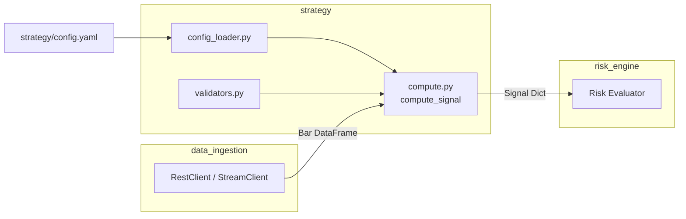

# Design Document: Strategy Engine

## Overview

The Strategy Engine is a pure-computation module that sits between Data Ingestion and Risk Engine in the Minions paper-trading pipeline. It receives validated OHLCV bar DataFrames from `data_ingestion`, computes short-window and long-window Simple Moving Averages (SMA) on the close price, detects crossover events between consecutive bars, and emits a structured signal dictionary (`BUY`, `SELL`, or `HOLD`) for the downstream Risk Engine to evaluate.

### Design Goals

- **Purity**: Zero side effects during signal computation — no network, no file I/O, no mutable global state.
- **Determinism**: Same inputs always produce the same outputs.
- **Explicitness**: Well-commented, readable code appropriate for a developer experienced in C++ but new to Python.
- **Testability**: Pure functions with clear input/output contracts enable comprehensive property-based testing.

### Key Design Decisions

1. **Functional core, imperative shell**: `compute_signal()` is a pure function. Configuration loading is the only I/O and happens once at initialization, before any signal computation.
2. **Independent bar-schema validation**: The strategy module defines its own `validate_bar_dataframe()` in `strategy/validators.py` using only pandas/numpy — no imports from `data_ingestion`. This ensures importing `strategy` never transitively loads Alpaca SDK classes (which `data_ingestion/__init__.py` pulls in), satisfying Requirement 5.1's zero-network-import goal.
3. **No class inheritance hierarchy**: A single `StrategyConfig` dataclass for configuration and a single public function `compute_signal()` keep the module flat and easy to understand.
4. **Hypothesis for property-based testing**: Consistent with the existing test infrastructure in `tests/test_properties.py`.

---

## Architecture



### Module Boundary

| Boundary | Direction | Data Shape |
|----------|-----------|-----------|
| `data_ingestion` → `strategy` | Input | `pandas.DataFrame` with UTC DatetimeIndex + OHLCV columns |
| `strategy` → `risk_engine` | Output | `dict` with keys: `signal`, `short_sma`, `long_sma`, `timestamp`, optional `symbol` |
| `strategy/config.yaml` → `strategy` | Config (init only) | YAML with `short_window` and `long_window` integer keys |

### Separation of Concerns

- **`config_loader.py`** — Reads and validates `strategy/config.yaml`. Only file I/O in the module.
- **`validators.py`** — Self-contained bar-schema validation using only pandas/numpy. No external module dependencies. Ensures strategy never transitively imports `data_ingestion` or Alpaca SDK.
- **`compute.py`** — Contains `compute_signal()`. Pure computation, no imports of networking or I/O libraries. Calls `validators.validate_bar_dataframe()` for schema checks.
- **`__init__.py`** — Public API surface. Re-exports `compute_signal`, `load_config`, and `validate_bar_dataframe`.

---

## Components and Interfaces

### 1. `strategy/config_loader.py`

```python
@dataclass
class StrategyConfig:
    """Validated configuration for the strategy module."""
    short_window: int   # SMA short window size (1–10000, < long_window)
    long_window: int    # SMA long window size (1–10000, > short_window)

def load_config(config_path: str) -> StrategyConfig:
    """
    Read strategy/config.yaml and return a validated StrategyConfig.

    Raises:
        FileNotFoundError: config file absent
        ValueError: invalid YAML, missing keys, or constraint violations
    """
```

**Algorithm** (mirrors `data_ingestion/config_loader.py` pattern):
1. Check file existence → `FileNotFoundError`
2. Parse YAML → `ValueError` on syntax error
3. Check required keys (`short_window`, `long_window`) → `ValueError` listing missing keys
4. Validate each value is an integer in [1, 10000] → `ValueError`
5. Validate `short_window < long_window` → `ValueError`
6. Return `StrategyConfig(...)`

### 2. `strategy/validators.py`

```python
import pandas as pd
import numpy as np

def validate_bar_dataframe(df: pd.DataFrame) -> None:
    """
    Validate that a DataFrame conforms to the Bar_DataFrame canonical schema.

    This is an independent implementation within the strategy module — it does
    NOT import from data_ingestion. This avoids transitively loading Alpaca SDK
    classes (which data_ingestion/__init__.py pulls in), satisfying
    Requirement 5.1's zero-network-import constraint.

    Checks:
      1. Index is a DatetimeIndex with UTC timezone.
      2. Required columns exist: open, high, low, close, volume.
      3. Column dtypes match: open/high/low/close are float64, volume is int64.

    Args:
        df: The DataFrame to validate (already confirmed to be a pd.DataFrame
            by the caller).

    Raises:
        ValueError: If any schema check fails. The message identifies the
                    first mismatch found.
    """
```

**Algorithm**:
1. Check `df.index` is a `pd.DatetimeIndex` → `ValueError` if not.
2. Check `df.index.tz` is UTC (via `str(df.index.tz) == "UTC"`) → `ValueError` if not.
3. Check required columns `{"open", "high", "low", "close", "volume"}` are all present → `ValueError` listing missing columns.
4. Check `open`, `high`, `low`, `close` are `float64` → `ValueError` identifying the first non-matching column.
5. Check `volume` is `int64` → `ValueError`.

**Dependencies**: Only `pandas` and `numpy` — no imports from `data_ingestion` or any networking library.

### 3. `strategy/compute.py`

```python
def compute_signal(
    df: pd.DataFrame,
    config: StrategyConfig,
    symbol: str | None = None,
) -> dict:
    """
    Compute SMA crossover signal from a bar DataFrame.

    Args:
        df: Bar DataFrame (UTC DatetimeIndex, OHLCV columns).
        config: Validated StrategyConfig with window sizes.
        symbol: Optional ticker string (1–10 chars) to include in output.

    Returns:
        dict with keys: signal, short_sma, long_sma, timestamp, and
        optionally symbol.

    Raises:
        TypeError: df is not a pandas DataFrame
        ValueError: schema mismatch, NaN in close, unsorted index,
                    or invalid symbol argument
    """
```

**Algorithm**:

1. **Type check**: Verify `df` is a `pandas.DataFrame` → `TypeError` if not.
2. **Schema validation**: Call `validate_bar_dataframe(df)` from `strategy.validators` → `ValueError` on mismatch.
3. **NaN check**: Count NaN values in `close` column → `ValueError` if any.
4. **Sort check**: Verify DatetimeIndex is strictly ascending → `ValueError` if not.
5. **Empty check**: If `len(df) == 0`, raise `ValueError` with message stating the DataFrame must contain at least one row.
6. **Symbol validation** (if provided): Must be a non-empty string of at most 10 characters → `ValueError` if invalid.
7. **Insufficient data check**: If `len(df) < config.long_window + 1`, return early with `{"signal": "HOLD", "short_sma": None, "long_sma": None, "timestamp": df.index[-1]}` — and include `"symbol": symbol` in the dict if a valid `symbol` argument was provided (same inclusion rule as the main return path).
8. **Compute SMAs**:
   - `short_sma_current` = mean of last `config.short_window` close prices
   - `long_sma_current` = mean of last `config.long_window` close prices
   - `short_sma_prev` = mean of close prices ending one bar before current, same window
   - `long_sma_prev` = mean of close prices ending one bar before current, same window
9. **Crossover detection**:
   - BUY: `short_sma_current > long_sma_current` AND `short_sma_prev <= long_sma_prev`
   - SELL: `short_sma_current < long_sma_current` AND `short_sma_prev >= long_sma_prev`
   - HOLD: otherwise
10. **Build and return result dict**.

### 4. `strategy/__init__.py`

```python
from strategy.config_loader import StrategyConfig, load_config
from strategy.compute import compute_signal
from strategy.validators import validate_bar_dataframe

__all__ = ["StrategyConfig", "load_config", "compute_signal", "validate_bar_dataframe"]
```

### 5. `strategy/config.yaml`

```yaml
# strategy/config.yaml
# SMA crossover parameters

# short_window: Number of bars for the fast (short) SMA.
# Must be an integer in [1, 10000] and strictly less than long_window.
short_window: 10

# long_window: Number of bars for the slow (long) SMA.
# Must be an integer in [1, 10000] and strictly greater than short_window.
long_window: 30
```

---

## Data Models

### Input: Bar DataFrame

The canonical bar schema is validated independently by `strategy/validators.py` (same checks as `data_ingestion/schemas.py` but without any import dependency on that module):

| Column | Dtype | Description |
|--------|-------|-------------|
| *(index)* | `DatetimeIndex[ns, UTC]` | UTC-aware timestamps, strictly ascending |
| `open` | `float64` | Opening price |
| `high` | `float64` | High price |
| `low` | `float64` | Low price |
| `close` | `float64` | Closing price (used for SMA) |
| `volume` | `int64` | Volume traded |

**Minimum rows required**: `long_window + 1` (to compute SMAs for both current and previous bar).

### Output: Signal Dictionary

```python
{
    "signal": "BUY" | "SELL" | "HOLD",        # Exactly one of three literals
    "short_sma": float | None,                 # Current short SMA value (None if insufficient data)
    "long_sma": float | None,                  # Current long SMA value (None if insufficient data)
    "timestamp": pd.Timestamp,                 # UTC-aware, from last row of input DataFrame
    "symbol": str,                             # OPTIONAL — included only if caller provides it
}
```

### Configuration: StrategyConfig

```python
@dataclass
class StrategyConfig:
    short_window: int   # Range: [1, 10000], must be < long_window
    long_window: int    # Range: [1, 10000], must be > short_window
```

---

## Correctness Properties

*A property is a characteristic or behavior that should hold true across all valid executions of a system — essentially, a formal statement about what the system should do. Properties serve as the bridge between human-readable specifications and machine-verifiable correctness guarantees.*

### Property 1: SMA computation matches independent calculation

*For any* valid Bar DataFrame with at least `long_window + 1` rows and any valid configuration, the `short_sma` and `long_sma` values in the returned dictionary SHALL equal the independently computed arithmetic mean (sum of last N close prices divided by N) within a tolerance of 1e-9.

**Validates: Requirements 2.1, 2.2, 2.3, 2.4, 2.5**

### Property 2: Signal matches crossover condition

*For any* valid Bar DataFrame with at least `long_window + 1` rows and any valid configuration, the returned `signal` SHALL be `"BUY"` if and only if `short_sma_current > long_sma_current` AND `short_sma_prev <= long_sma_prev`; `"SELL"` if and only if `short_sma_current < long_sma_current` AND `short_sma_prev >= long_sma_prev`; and `"HOLD"` in all other cases — where the SMA values are computed independently from the close prices.

**Validates: Requirements 3.1, 3.2, 3.3, 3.4, 3.5**

### Property 3: Output structure invariant

*For any* valid invocation of `compute_signal` that does not raise an exception, the returned dictionary SHALL contain exactly the keys `signal`, `short_sma`, `long_sma`, `timestamp` (plus `symbol` if and only if a valid symbol argument was provided); `timestamp` SHALL equal `df.index[-1]` and be UTC-aware; and `signal` SHALL be one of `"BUY"`, `"SELL"`, or `"HOLD"`.

**Validates: Requirements 6.1, 6.2, 6.3, 6.4**

### Property 4: Non-DataFrame input raises TypeError with type name

*For any* value that is not a `pandas.DataFrame` instance (including `None`, integers, strings, lists, dicts), calling `compute_signal` with that value as the `df` argument SHALL raise a `TypeError` whose message string contains the name of the actual type received.

**Validates: Requirements 1.1**

### Property 5: NaN in close column raises ValueError with count

*For any* valid Bar DataFrame where one or more close values are replaced with NaN, calling `compute_signal` SHALL raise a `ValueError` whose message contains the exact number of NaN values present in the close column.

**Validates: Requirements 1.3**

### Property 6: Unsorted index raises ValueError

*For any* valid Bar DataFrame with 2 or more rows whose DatetimeIndex is permuted into non-ascending order, calling `compute_signal` SHALL raise a `ValueError` whose message indicates the index must be sorted in ascending order.

**Validates: Requirements 1.4**

### Property 7: Insufficient data returns HOLD with None SMAs (and symbol if provided)

*For any* valid Bar DataFrame with fewer than `long_window + 1` rows (but at least 1 row) and any valid configuration, calling `compute_signal` SHALL return a dictionary with `signal` equal to `"HOLD"`, `short_sma` equal to `None`, `long_sma` equal to `None`, `timestamp` equal to the last row's DatetimeIndex value, and — if a valid `symbol` argument was provided — `symbol` equal to that string (if no symbol was provided, the key SHALL be absent).

**Validates: Requirements 1.2, 6.3, 6.4**

### Property 8: Determinism — identical inputs produce identical outputs

*For any* valid Bar DataFrame, valid configuration, and optional symbol argument, calling `compute_signal` twice with the same arguments SHALL produce dictionaries that are exactly equal (same `signal`, same `timestamp`, same `symbol`) with `short_sma` and `long_sma` equal within 1e-9 tolerance.

**Validates: Requirements 7.1, 7.3**

### Property 9: Invalid config values always raise ValueError

*For any* YAML configuration where `short_window` or `long_window` is not an integer in [1, 10000], or where `short_window >= long_window`, calling `load_config` SHALL raise a `ValueError` whose message identifies the invalid key.

**Validates: Requirements 4.5, 4.6, 4.7**

### Property 10: Invalid symbol raises ValueError

*For any* value passed as the `symbol` argument that is not a string, or is an empty string, or exceeds 10 characters, calling `compute_signal` SHALL raise a `ValueError` whose message states that symbol must be a non-empty string.

**Validates: Requirements 6.5**

### Property 11: Empty DataFrame raises ValueError

*For any* valid Bar DataFrame that passes schema validation but contains zero rows, calling `compute_signal` SHALL raise a `ValueError` whose message states that the DataFrame must contain at least one row.

**Validates: Requirements 1.5**

---

## Error Handling

### Error Hierarchy

All errors raised by the strategy module fall into three categories:

| Error Type | When Raised | Meaning |
|-----------|-------------|---------|
| `FileNotFoundError` | `load_config()` | Config file not found at expected path |
| `TypeError` | `compute_signal()` | `df` argument is not a pandas DataFrame |
| `ValueError` | `load_config()` or `compute_signal()` | Data/config fails validation |

### Error Propagation Strategy

- **Fail fast**: Validation checks run in a defined order. The first failure raises immediately — no partial computation occurs.
- **Descriptive messages**: Every error message names the specific problem (type received, column name, NaN count, missing key, etc.) to enable quick debugging.
- **No exception swallowing**: The module never catches and silences exceptions. Callers (Risk Engine, logging) see the raw exception.

### Validation Order in `compute_signal()`

1. Type check → `TypeError`
2. Schema validation → `ValueError`
3. NaN check on close → `ValueError`
4. Index sort check → `ValueError`
5. Empty DataFrame check → `ValueError`
6. Symbol argument validation → `ValueError`
7. Insufficient data → early return (not an error)
8. Computation (no errors possible on valid data)

### Validation Order in `load_config()`

1. File existence → `FileNotFoundError`
2. YAML parsing → `ValueError`
3. Required keys present → `ValueError`
4. Value type and range → `ValueError`
5. Relationship constraint (short < long) → `ValueError`

---

## Testing Strategy

### Testing Framework

- **pytest** — test runner (already in `requirements.txt`)
- **Hypothesis** — property-based testing library (already in `requirements.txt`, used in existing `tests/test_properties.py`)

### Dual Testing Approach

#### Property-Based Tests (Hypothesis)

Each correctness property maps to one property-based test function, configured with `@settings(max_examples=100)` minimum. Tests are tagged with comments referencing the design property:

```python
# Feature: strategy-engine, Property 1: SMA computation matches independent calculation
```

Properties 1–10 from the Correctness Properties section above will each be implemented as a single Hypothesis property test.

**Generator strategies needed:**
- `valid_bar_dataframe(min_rows, max_rows)` — generates DataFrames conforming to the Bar schema with random close prices
- `valid_strategy_config()` — generates `StrategyConfig` with `short_window < long_window` and both in [1, 200] (capped for test performance)
- `invalid_df_values()` — generates non-DataFrame values (None, int, str, list, dict, etc.)
- `valid_symbol()` — generates non-empty strings of 1–10 characters
- `invalid_symbol()` — generates empty strings, None, integers, or strings > 10 chars

#### Unit Tests (Example-Based)

Targeted tests for specific scenarios not well-covered by property tests:

- `test_config_file_not_found` — verifies `FileNotFoundError` with path in message
- `test_config_invalid_yaml_syntax` — verifies `ValueError` on malformed YAML
- `test_config_loads_default_values` — verifies default config.yaml loads correctly
- `test_buy_signal_specific_example` — a hand-crafted crossover scenario producing BUY
- `test_sell_signal_specific_example` — a hand-crafted crossover scenario producing SELL
- `test_hold_signal_no_crossover` — a hand-crafted non-crossover scenario

#### Static Analysis / Smoke Tests

- `test_no_forbidden_imports` — AST scan of all `.py` files in `strategy/` verifying no networking, subprocess, or trading client imports (validates Requirements 5.1–5.6)

### Test File Organization

```
tests/
├── test_strategy_properties.py    # Property-based tests (Properties 1–10)
├── test_strategy_unit.py          # Example-based unit tests
└── test_strategy_purity.py        # AST-scan smoke tests for Requirement 5
```

### Property Test Configuration

- Minimum 100 iterations per property test (`@settings(max_examples=100)`)
- Each test tagged: `Feature: strategy-engine, Property {N}: {title}`
- DataFrame generators capped at 200 rows max and window sizes at 200 for test performance
- Tests use the same `_make_valid_bar_df()` helper pattern established in `tests/test_properties.py`

